#  一、面向对象的基本概念

## 1.1 什么是面向对象？

面向对象是一种编程的思想，编程的方式。

面向过程是另一种非常经典的编程思想。

面向过程是以步骤/过程为中心，面向对象是以类和对象为中心。

举例：把大象装进冰箱的代码实现

面向过程：

- 第一步：把冰箱门打开
- 第二步：把大象装进去
- 第三步：把冰箱门关上

面向对象：

角色/对象：人、冰箱、大象

每一个角色需要完成什么事，能干什么事，或具有什么功能：

- 人：推和拉的能力
- 大象：走
- 冰箱：打开，关上，冷冻…

```
public class 人{
    public void 推(东西){
        //....
    }
    public void 拉(东西){
        //....
    }
}
public class 大象{
    public void 走(){
        //...
    }
}
public class 冰箱{
    public void 打开(){
        //...
    }
    public void 关上(){
        //...
    }
    public void 冷冻(){
        //...
    }
}
public class 主类{
    public static void main(String[] args){
        人 ren = new 人("张三");
        大象 e = new 大象("亚洲", 10 );
        冰箱 b = new 冰箱("格力", 5,10,10);
        
        ren.拉(b);
        ren.拉(e);
        ren.推(e);
        ren.推(b);
    }
}
```

举例：

小孙：单干

面向过程：

- 第一步：找项目
- 第二步：沟通需求
- 第三步：实现代码
- 第四步：测试
- 第五步：交接产品
- 第六步：维护

小孙：成立公司

面向过程：具体步骤的实施者

面向对象：找合适的类和对象帮你完成你想要实现的事情，指挥者

- 找专门谈项目的人：注重他有没有谈项目的能力
- 找写代码的人
  - 找前端开发人员：注重他前端开发的能力
  - 找后端开发人员：注重它后端开发的能力
- 找专门的财务
- 找人事

找合适的人完成具体的事

## 1.2 类与对象的概念

1、什么是类

生活中把事物也会进行分“类”。

Java中也要进行“分类”，把一类具有`相同特性/特征`的事物用一个Java来描述。例如：

要做一个学生考试管理系统，学生：张三、李四、王五等，他们的共同特征：

- 数据特征：姓名、年龄、性别、身份号码… => 类的属性
- 行为特征：注册、登录、考试、查看成绩… => 类的方法

总结：一类具有相同特性的事物的`抽象`描述。

2、什么是对象

对象是指这类事物的一个`具体`的个体，实体。

3、类与对象的关系

类是创建对象的模板，设计图。比喻：造汽车，先有汽车的设计图。设计图中体现了这里车的所有特征/构造/结构和功能。

对象是具体的实例，个体。比喻：对象是具体的一辆车，能开的车。

## 1.3 如何声明类和创建对象？

先有类还是先有对象？

从需求分析/设计项目的角度：先观察对象，才能总结有哪些类？

从代码实现的角度来说：先声明类，后创建对象。

### 1、声明类的格式（必须掌握）

```
【修饰符】 class 类名{
    
}
```

暂时今天类的修饰符只写public。public的类有一个要求，类名与xx.java的源文件名必须一致。

类名：见名知意。遵循大驼峰命名法，即每一个单词首字母大写。

```
public class Student {
}
```

### 2、创建对象的格式（必须掌握）

```
类名 对象名 = new 类名();
```

new是用来创建实例对象的关键字，实际意义是在堆中开辟一块内存用于存储对象的信息。例如：创建数组对象时，在堆中开辟一块空间，用来存储数组的元素。

```
public class TestStudent {//主类，包含主方法的类
    public static void main(String[] args) {
        Student s1 = new Student();
        Student s2 = new Student();
        Student s3 = new Student();

        System.out.println(s1);//Student@4eec7777
        System.out.println(s2);//Student@3b07d329
        System.out.println(s3);//Student@41629346
        //s1,s2,s3都是引用数据类型的变量，s1,s2,s3中都是存储对象的首地址。
        //这一点与数组一样

        int[] arr = {1,2,3,4};
        System.out.println(arr);//[I@404b9385
    }
}
```

Student是一个类，也是一种数据类型，称为类类型。它与String是一样的。只不过String是JRE核心类库中已经提前写好的类，Student是咱们自己写的类。同理，数组类型，例如：int[]，String[]，double[]也是数据类型，是数组类型。它们统统都是引用数据类型。

## 1.4 包（认识，会创建即可）

### 1.4.1 包的作用

- 可以通过不同的文件夹/包帮我们管理众多的类，分门别类进行管理，便于后期的维护
- 可以避免类的重名，有了包之后，类的全名称就是包.类名
- 包结合权限修饰符（public，protected，缺省，private等）来限定类或成员可见性范围。关于权限修饰符后面再讲。

### 1.4.2 如何声明包？

```
package 包名;
```

- 这句代码必须在源文件的首行。
- 包名的命名规范：所有单词都小写，单词直接使用.分割。习惯上用公司域名倒置的写法，例如：[com.atguigu.xxx](http://com.atguigu.xxx/)

在IDEA中这样操作：

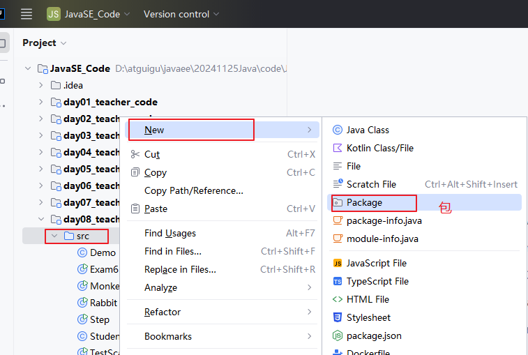


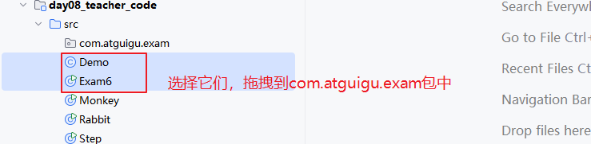

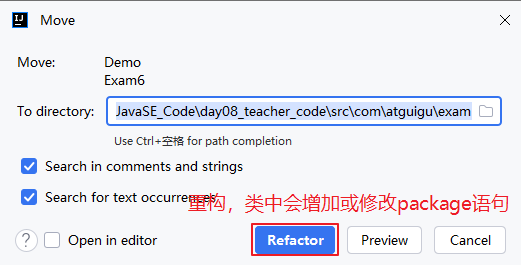

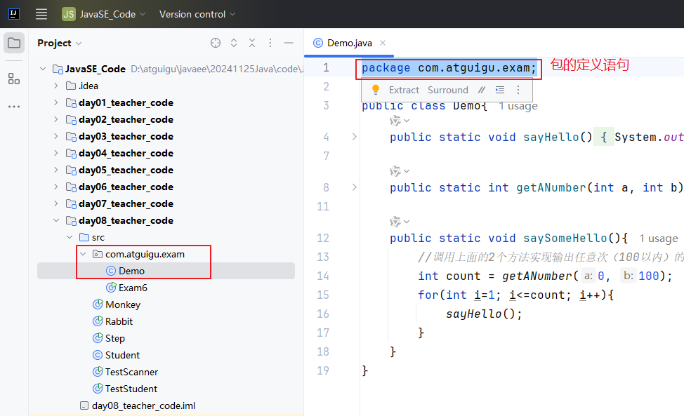

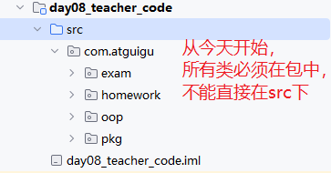

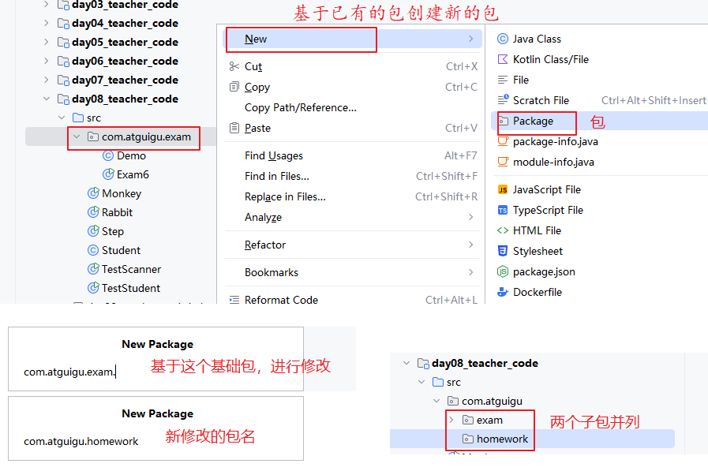

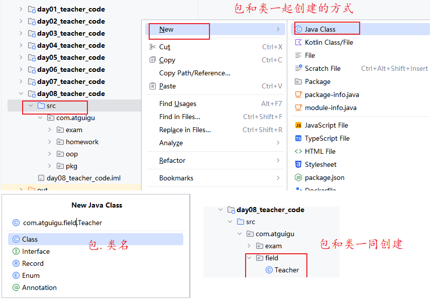

### 1.4.3 如何跨包使用类

- 如果是同一个包，类之间互相使用，不需要import
- 如果是跨包（不同包），类之间互相使用，必须import 或 使用类的全名称
- 只有public修饰的类才能跨包使用
- java.lang包的类，在任意地方使用都不需要导包，例如：String，Math，System 它们都是java.lang包的类

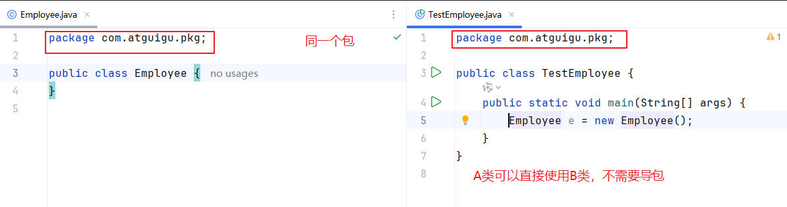

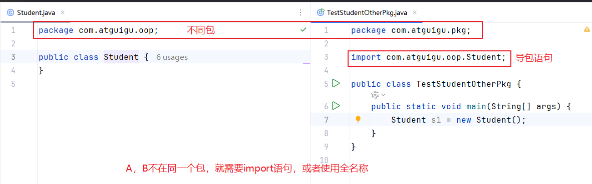

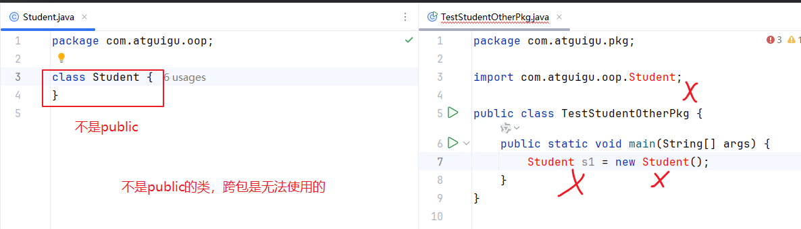

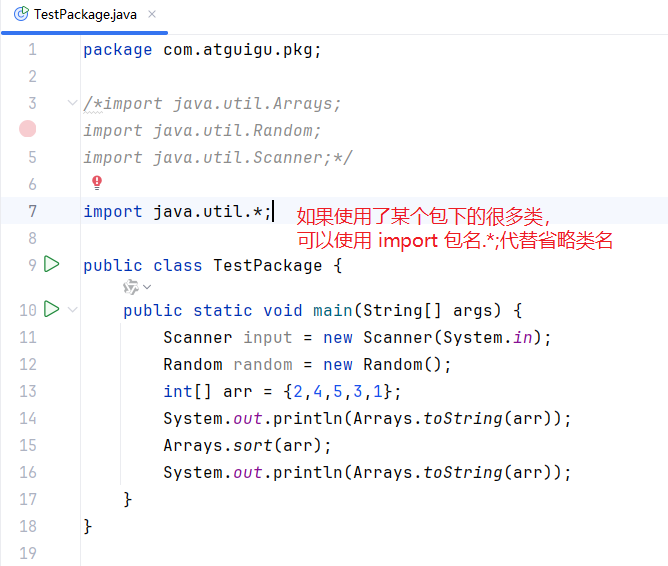

```
package com.atguigu.pkg;

import java.util.Arrays;
import java.util.Date;
import java.util.Random;
import java.util.Scanner;

public class TestPackage {
    public static void main(String[] args) {
        Scanner input = new Scanner(System.in);
        Random random = new Random();
        int[] arr = {2,4,5,3,1};
        System.out.println(Arrays.toString(arr));
        Arrays.sort(arr);
        System.out.println(Arrays.toString(arr));

        /*
        使用不同包的，同名词的类
        java.util.Date类
        java.sql.Date类
        如果两个类都要用，只能一个是import，一个是全名称。或者两个都全名称。
         */
        Date d = new Date();
        java.sql.Date d2 = new java.sql.Date(2024,12,3);
    }
}
```

## 1.5 类的成员之一：成员变量（必须掌握）

### 1.5.1 成员变量的声明格式

```
【修饰符】 class 类名{
    【修饰符】 数据类型 变量名;
}
```

成员变量的声明位置：类中方法外。

如果把变量定义/声明到方法里面，那就是局部变量，不是成员变量。

【修饰符】：暂时都是public

### 1.5.2 成员变量的分类

#### 1、静态变量

静态变量不依赖于对象，不属于对象，属于类。跨类使用它，建议通过“类名.静态变量”。也可以通过“对象.静态变量”。

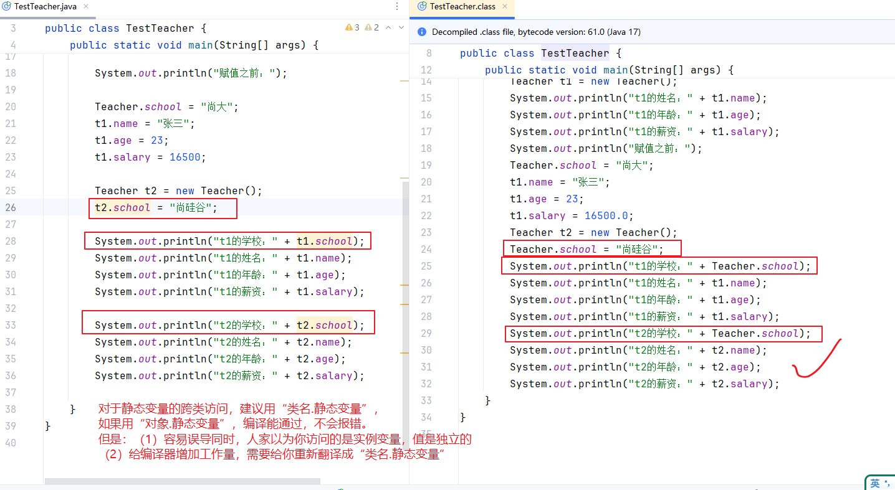

#### 2、实例变量/非静态成员变量

实例变量依赖于对象，属于对象。跨类使用它，必须通过“对象.实例变量”。

### 1.5.3 成员变量的特点

#### 1、成员变量有默认值

| 类型                           | 默认值   |
| ------------------------------ | -------- |
| byte                           | 0        |
| short                          | 0        |
| int                            | 0        |
| long                           | 0L       |
| float                          | 0.0F     |
| double                         | 0.0      |
| char                           | ‘\u0000’ |
| boolean                        | false    |
| String等类、数组等引用数据类型 | null     |

#### 2、是否共享性特点

`静态变量`的值是所有对象`共享的`，因为它属于类，而类是创建对象模板。

`实例变量`的值是每一个对象`独立的`，因为它属于某个对象。

> 问：成员变量该不该加static？
>
> 原则：看这个成员变量的值是不是所有对象共享的，只存一份的，如果是，就应该是静态的，否则就不能是静态的。

### 1.5.4 示例代码

```
package com.atguigu.field;

public class Teacher {
    //静态变量，静态成员变量，学校名是所有老师共享的
    public static String school;

    //实例变量，非静态成员变量，姓名、年龄、薪资是每一个老师独立的
    public String name;//姓名
    public int age;//年龄
    public double salary;//薪资
}
package com.atguigu.field;

public class TestTeacher {
    public static void main(String[] args) {
//        System.out.println("姓名：" + name);//错误，name在Teacher类中
       // System.out.println("姓名：" + Teacher.name);//错误，因为name没有static

        System.out.println("学校：" + Teacher.school);//null

        Teacher t1 = new Teacher();//创建对象，创建实例
        System.out.println("t1的姓名：" + t1.name);//null
        System.out.println("t1的年龄：" + t1.age);//0
        System.out.println("t1的薪资：" + t1.salary);//0.0

//        int a;//局部变量
//        System.out.println("a = " + a);//报错，因为a没有初始化

        System.out.println("赋值之前：");

        Teacher.school = "尚大";
        t1.name = "张三";
        t1.age = 23;
        t1.salary = 16500;

        Teacher t2 = new Teacher();
        t2.school = "尚硅谷";//推荐用 Teacher.school = "尚硅谷";

        System.out.println("t1的学校：" + t1.school);//推荐用 Teacher.school
        System.out.println("t1的姓名：" + t1.name);
        System.out.println("t1的年龄：" + t1.age);
        System.out.println("t1的薪资：" + t1.salary);

        System.out.println("t2的学校：" + t2.school);//推荐用 Teacher.school
        System.out.println("t2的姓名：" + t2.name);
        System.out.println("t2的年龄：" + t2.age);
        System.out.println("t2的薪资：" + t2.salary);

    }
}
package com.atguigu.field;

public class Chinese {//中国人
    //国家名是所有中国人共享的，所以是静态的
    private static String country;
    
    //每一个中国人的名字是独立的，所以是非静态的
    private String name;
}
package com.atguigu.field;

public class Account {//银行账号
    //银行利率是大家统一的，所以是静态的
    private static double rate;//利率
    
    //余额是每个人不同的，所以是非静态的
    private double balance;//余额
}
```

### 1.5.5 引用数据类型的成员变量

```
package com.atguigu.field;

public class Husband {//丈夫
    //以下是两个引用数据类型的实例变量
    public String name;
    public Wife wife;
}
package com.atguigu.field;

public class Wife {//妻子
    //以下是两个引用数据类型的实例变量
    public String name;
    public Husband husband;
}
package com.atguigu.field;

public class TestHusbandWife {//主类，测试类
    public static void main(String[] args) {
        Husband h = new Husband();
        h.name = "张三";

        Wife w = new Wife();
        w.name = "翠花";

        h.wife = w;//给h.wife变量赋值一个Wife类型的对象
        w.husband = h;

        System.out.println("丈夫的姓名：" + h.name +"，他妻子的姓名：" + h.wife.name);
        System.out.println("妻子的姓名：" + w.name +"，她的丈夫的姓名：" + w.husband.name);
    }
}
```

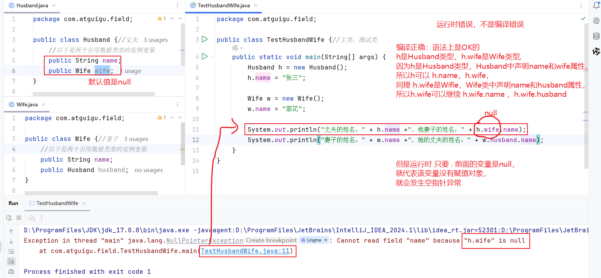

### 1.5.6 成员变量的内存分析

#### 1、实例变量的内存分析

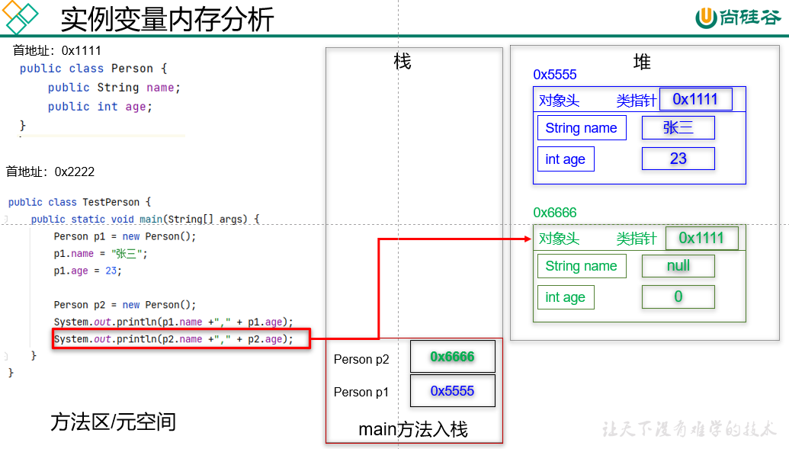

#### 2、静态变量与实例变量的内存分析

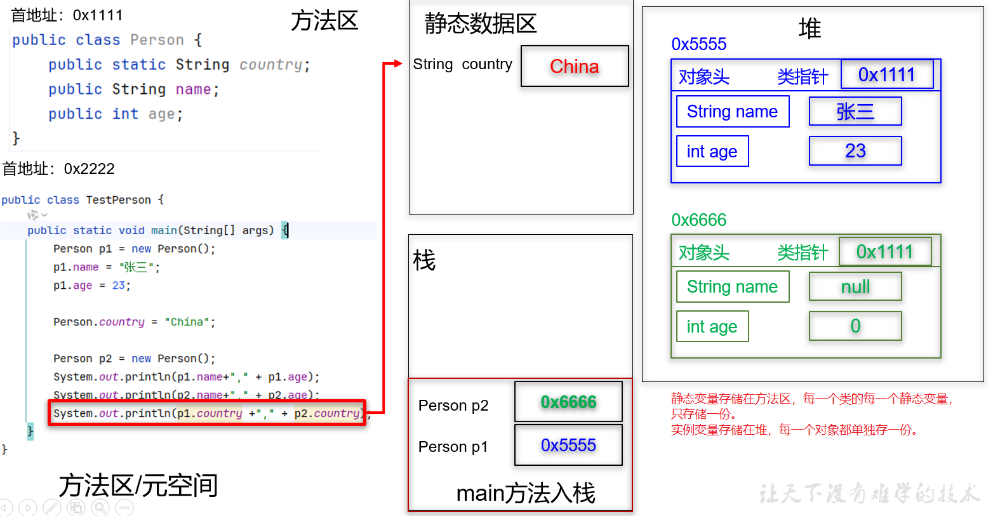

#### 3、引用数据类型成员变量的内存分析

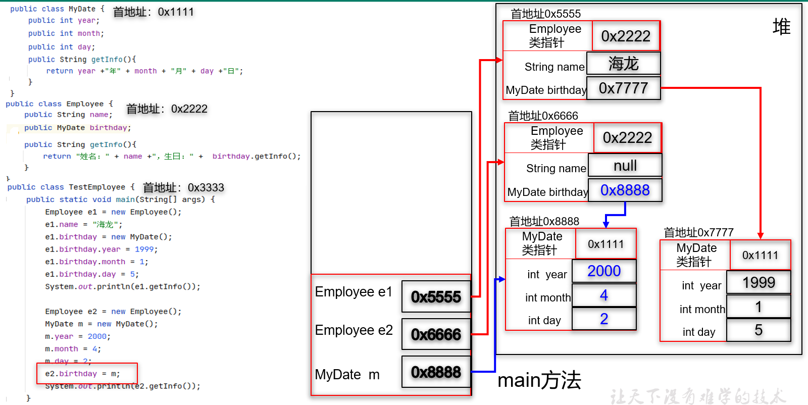

### 1.5.7 静态变量与实例变量的区别

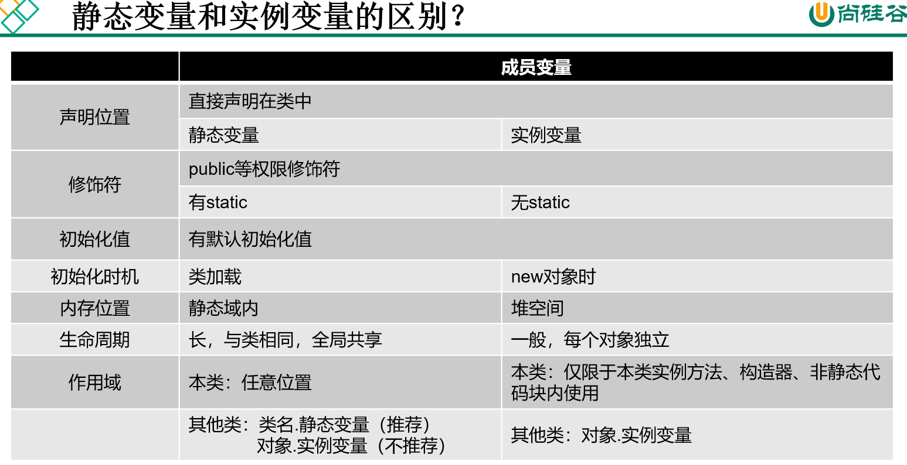

## 1.6 类的成员之二：成员方法（必须掌握）

### 1.6.1 成员方法的声明格式

```
【修饰符】 class 类名{
    【修饰符】 返回值类型 方法名(【形参列表】){
        方法体语句;
    }
}
```

### 1.6.2 成员方法的分类

#### 1、静态方法

- 静态方法中，`只可以`访问本类的静态成员，包括本类的静态方法和静态变量。
- 跨类调用静态方法，建议使用“类名.静态方法”，当然也可以通过“对象.静态方法”。

#### 2、实例方法/非静态方法

- 实例方法中，可以访问本类的所有成员，包括本类的静态成员和非静态成员。
- 跨类调用非静态方法/实例方法，`只可以`通过“对象.非静态方法”的方式。

> 问：什么时候用静态方法，什么时候用非静态方法呢？
>
> 答：原则，如果在方法体中，需要访问本类的非静态成员，那么这个方法只能是非静态的。
>
>  反过来，如果在方法体中，不需要访问本类的非静态成员，那么这个方法 可以是静态的，也可以是非静态的。当然定义为静态的，更简单。

```
package com.atguigu.method;

public class Chinese {//中国人的类
    public static String country;//静态变量
    public String name;//实例变量

    //静态方法中只能访问本类的静态成员，包括本类的静态变量，静态方法
    //不可以直接访问本类的实例成员，包括实例变量，实例方法
    public static void printCountry(){
        System.out.println("国家名：" + country);
        //System.out.println("姓名：" + name);//错误
    }

    //实例方法中可以访问本类的所有成员，包括静态的和非静态的
    public void printInfo(){
        System.out.println("国家名：" + country);
        System.out.println("姓名：" + name);
    }
}
package com.atguigu.method;

public class TestChinese {
    public static void main(String[] args) {
        Chinese.country = "中国";
        Chinese.printCountry();

//        Chinese.printInfo();//错误，实例方法跨类调用，只能通过“对象.实例方法”
        Chinese c1 = new Chinese();
        c1.name = "张三";
        c1.printInfo();
        c1.printCountry();//不推荐
    }
}
```

### 1.6.3 声明成员方法的意义

方法的定义：一个独立的可复用的功能。

#### 版本1：没有成员方法

```
package com.atguigu.method;

public class Triangle {//三角形类
    public double a;
    public double b;
    public double c;
}
package com.atguigu.method;

public class TestTriangle {
    public static void main(String[] args) {
        Triangle t1 = new Triangle();
        t1.a = 3;
        t1.b = 4;
        t1.c = 5;

        double p = (t1.a+t1.b+t1.c)/2;
        double area = Math.sqrt(p * (p-t1.a) * (p-t1.b) * (p-t1.c));
        double perimeter = t1.a + t1.b + t1.c;
        System.out.println("三角形的边长：" + t1.a +"," +t1.b+"," + t1.c +"，面积：" + area +"，周长：" + perimeter);

        Triangle t2 = new Triangle();
        t2.a = 6;
        t2.b = 6;
        t2.c = 6;

        double p2 = (t2.a+t2.b+t2.c)/2;
        double area2 = Math.sqrt(p2 * (p2-t2.a) * (p2-t2.b) * (p2-t2.c));
        double perimeter2 = t2.a + t2.b + t2.c;

        System.out.println("三角形的边长：" + t2.a +"," +t2.b+"," + t2.c +"，面积：" + area2 +"，周长：" + perimeter2);
    }
}
```

#### 版本2：在测试类中抽取公共代码成方法

```
package com.atguigu.method;

public class Triangle {//三角形类
    public double a;
    public double b;
    public double c;
}
package com.atguigu.method;

public class TestTriangle {
    public static void main(String[] args) {
        Triangle t1 = new Triangle();
        t1.a = 3;
        t1.b = 4;
        t1.c = 5;

       double area = getArea(t1.a, t1.b,t1.c);
        double perimeter = getPerimeter(t1.a, t1.b,t1.c);
        System.out.println("三角形的边长：" + t1.a +"," +t1.b+"," + t1.c +"，面积：" + area +"，周长：" + perimeter);

        Triangle t2 = new Triangle();
        t2.a = 6;
        t2.b = 6;
        t2.c = 6;

        double area2 = getArea(t2.a, t2.b, t2.c);
        double perimeter2 = getPerimeter(t2.a, t2.b, t2.c);
        System.out.println("三角形的边长：" + t2.a +"," +t2.b+"," + t2.c +"，面积：" + area2 +"，周长：" + perimeter2);
    }

    public static double getArea(double a, double b, double c){
        double p = (a+b+c)/2;
        double area = Math.sqrt(p * (p-a) * (p-b) * (p-c));
        return area;
    }

    public static double getPerimeter(double a, double b, double c){
        double perimeter = a + b + c;
        return perimeter;
    }
}
```

#### 版本3：在三角形类中抽取成员方法

求面积、求周长、返回三角形信息这些功能是每一个三角形对象都有的共同行为特征，所以在三角形类中定义成员方法最合适。

```
package com.atguigu.method;

public class Triangle {//三角形类
    public double a;
    public double b;
    public double c;

    public double getArea(){
        double p = (a+b+c)/2;
        double area = Math.sqrt(p * (p-a) * (p-b) * (p-c));
        return area;
    }

    public double getPerimeter(){
        double perimeter = a + b + c;
        return perimeter;
    }

    public String getInfo(){
        return "三角形的边长：" + a+"," +b +"," +c + "，面积：" + getArea()+"，周长：" + getPerimeter();
    }
}
package com.atguigu.method;

public class TestTriangle {
    public static void main(String[] args) {
        Triangle t1 = new Triangle();
        t1.a = 3;
        t1.b = 4;
        t1.c = 5;
        System.out.println(t1.getInfo());

        Triangle t2 = new Triangle();
        t2.a = 6;
        t2.b = 6;
        t2.c = 6;
        System.out.println(t2.getInfo());
    }
}
```

### 1.6.4 练习题改版

#### 版本1：没有定义成员方法

```
package com.atguigu.exer5;

//成员变量，俗称属性
public class MyDate {//自定义的日期类型
    public int year;
    public int month;
    public int day;
}
package com.atguigu.exer5;

public class Employee {
    public String name;
    public MyDate birthday;
}
package com.atguigu.exer5;

public class TestMyDate {
    public static void main(String[] args) {
        MyDate childrenDay = new MyDate();
        childrenDay.year = 2024;
        childrenDay.month = 6;
        childrenDay.day = 1;

        MyDate programmerDay = new MyDate();
        programmerDay.year = 2024;
        programmerDay.month = 10;
        programmerDay.day = 24;

        System.out.println("今年的六一儿童节：" + childrenDay.year+"-" + childrenDay.month+"-" + childrenDay.day);
        System.out.println("今年的程序员节：" + programmerDay.year+"-" + programmerDay.month+"-" + programmerDay.day);

    }
}
package com.atguigu.exer5;

public class TestEmployee {
    public static void main(String[] args) {
        Employee e1 = new Employee();

        /*
        Java是对数据类型非常严格编程语言，有的人称为强类型语言。
        这就决定了，每使用一个变量，都要关注它的“类型”
        e1 它是Employee类型   ==> 可以.出Employee类的成员
        e1.name 它是String类型  =>  (1)必须给它赋值一个String类型的对象（String比较特殊，它的对象没有明确的new）
                                   (2)e1.name 可以继续 . 出 String类中的成员（暂时不关注）
        e1.birthday 它是MyDate类型  ==> （1）必须给它赋值一个MyDate类型的对象
                                       （2） e1.birthday 可以继续 . 出 MyDate类中的成员
         */
        e1.name = "张三";
        //给e1的生日赋值的写法（一）
        e1.birthday = new MyDate();
        e1.birthday.year = 2000;
        e1.birthday.month = 5;
        e1.birthday.day = 1;


        Employee e2 = new Employee();
        e2.name ="李四";
        MyDate m = new MyDate();//先单独准备一个MyDate，此时m和e2没有关系
        m.year = 2001;
        m.month = 6;
        m.day = 8;
        //接下来把m对象赋值给e2的birthday，建立联系
        //给e1的生日赋值的写法（二）
        e2.birthday = m;

        System.out.println("e1的姓名：" + e1.name +"，生日：" + e1.birthday.year+"-" + e1.birthday.month +"-" + e1.birthday.day);
        System.out.println("e2的姓名：" + e2.name +"，生日：" + e2.birthday.year+"-" + e2.birthday.month +"-" + e2.birthday.day);
    }
}
```

#### 版本2：定义成员方法

```
package com.atguigu.exer5_2;

//成员变量，俗称属性
public class MyDate {//自定义的日期类型
    public int year;
    public int month;
    public int day;

    /*public void setDate(int y, int m ,int d){
        year = y;
        month = m;
        day = d;
    }*/
    public void setDate(int year, int month ,int day){
        this.year = year;
        this.month = month;
        this.day = day;
        //左边代表的是当前对象的成员变量，右边是形参变量
        //this是当前对象，它是一个代词，要根据上下文才能推断它代表哪个对象
    }

    public String getDateInfo(){
//        return this.year+"-" + this.month+"-" + this.day;
        return year+"-" + month+"-" + day;
        //当成员变量与局部变量（形参也是局部变量）重名时，需要在成员变量前面加this.
        //如果没有重名问题，可以省略this.，直接访问本类的成员变量
    }
}
package com.atguigu.exer5_2;

public class TestMyDate {
    public static void main(String[] args) {
        MyDate childrenDay = new MyDate();
        childrenDay.setDate(2024,6,1);

        MyDate programmerDay = new MyDate();
        programmerDay.setDate(2024,10,24);

        //childrenDay变量是MyDate类型， => childrenDay可以 . 出MyDate类的成员
        //包括成员变量，和成员方法
        System.out.println("今年的六一儿童节：" + childrenDay.getDateInfo());
        System.out.println("今年的程序员节：" + programmerDay.getDateInfo());
    }
}
package com.atguigu.exer5_2;

public class Employee {
    public String name;
    public MyDate birthday;

    public void setInfo(String name , MyDate birthday){
        this.name = name;
        this.birthday = birthday;
    }

    public void setInfo(String name , int year, int month, int day){
        this.name = name;
        this.birthday = new MyDate();
        this.birthday.setDate(year,month,day);
    }

    public String getInfo(){
        //return "姓名：" +name +"生日：" + birthday.year+"-" + birthday.month +"-" + birthday.day;
        //birthday是MyDate类型的变量 => birthday可以. 出MyDate类的成员，包括成员变量和成员方法
        return "姓名：" +name +"生日：" + birthday.getDateInfo();
    }
}
package com.atguigu.exer5_2;

public class TestEmployee {
    public static void main(String[] args) {
        Employee e1 = new Employee();
/*
        MyDate m1 = new MyDate();
        m1.setDate(2000,5,1);
        e1.setInfo("张三",m1 );*/
        e1.setInfo("张三",2000,5,1);


        Employee e2 = new Employee();
        /*MyDate m2 = new MyDate();
        m2.setDate(2001,6,8);
        e2.setInfo("李四",m2);*/
        e2.setInfo("李四",2001,6,8);

        System.out.println("e1的" + e1.getInfo());
        System.out.println("e2的" + e2.getInfo());
    }
}
```

### 1.6.5 this关键字

1、在方法中什么情况下需要用this？

当成员变量（这里特指实例变量）与局部变量重名时，在成员变量前面加“this.”，不重名，不需要加。

2、在方法中this代表的是什么？

代表“调用” “当前方法” 的“对象”。

> 思考题：静态方法中有没有this？
>
> 答案：没有。因为静态方法是属于类的，通过“类名."进行调用。

### 1.6.6 实例方法调用内存分析

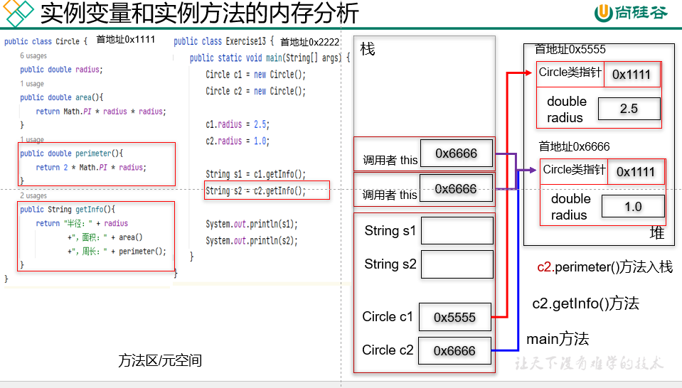

### 1.6.7 静态变量、实例变量、局部变量的区别

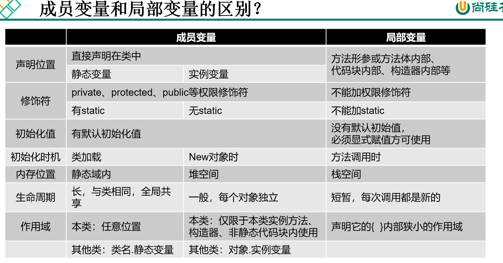

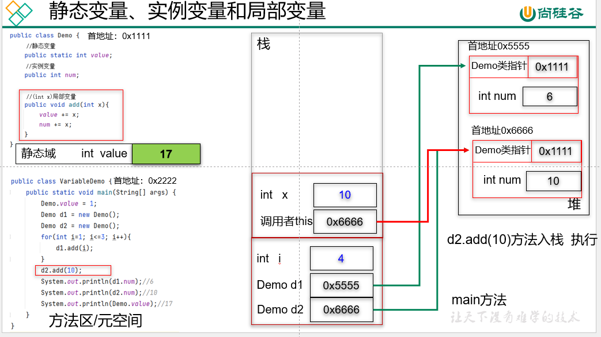

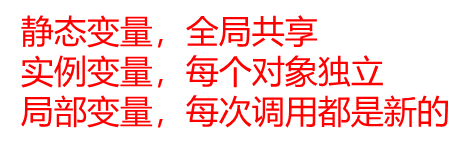