#  一、运算符

## 1.1 复习

- 赋值运算符：=
- 算术运算符：+，-，*，/，%，++，–
- 赋值结合算术运算符：+=，-=，*=，/=，%=
- 关系运算符：>，<，>=，<=，==，!=
- 逻辑运算符：&，&&，|，||，^，!
- 条件运算符：? :

## 1.2 位运算符（难点，使用场景较少）

为什么位运算符比较难？因为它是基于`二进制补码`进行计算的，所以不直观。

### 1、位移：左移、右移、无符号右移

- 左移：<<：
  - 快速口诀：左移几位，等于乘以2的几次方
  - 底层原理：左边几位，二进制补码左边截掉几位，右边补几个0
- 右移：>>
  - 快速口诀：右移几位，等于除以2的几次方
  - 底层原理：右移几位，二进制补码右边截掉几位，左边补几个0或1，原来最高位是0补0，是1补1
- 无符号右移：>>>
  - 对于正数来说，无符号右移与普通右移相同
  - 对于负数来说，右移几位，二进制补码右边截掉几位，左边补几个0，负数变正数

以上三种移位，只有负数的>>右移会在最高位补1，其余移位都是补0。

以上三种移位，左移和负数的无符号右移会出现符号位改变。左移可能出现正变负，负变正，负数的无符号右移让负数变正数。

当移动的位数超过当前类型的总位数时，会先处理移位 n % 当前的总位数 = 最终的移位数

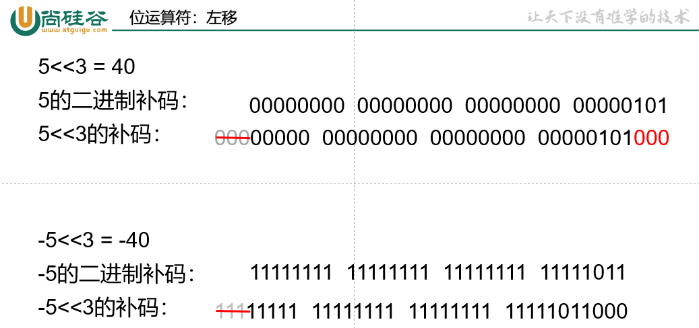 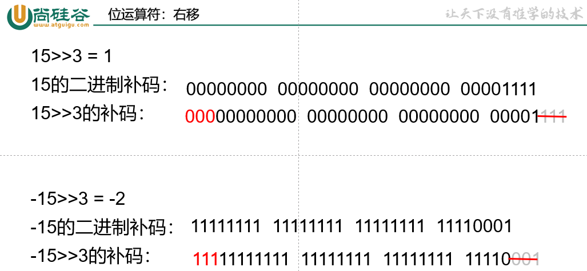 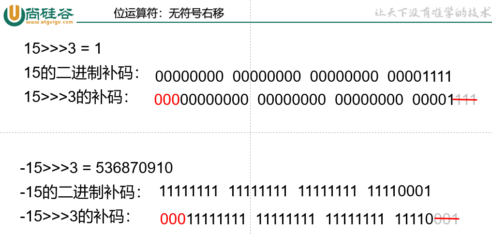

```java
public class TestBitMove {
    public static void main(String[] args) {
        System.out.println(3 << 2);
      
// 左移
        /*
        3的二进制：00000000 00000000 00000000 00000011
        3<<2     00000000 00000000 00000000 00001100

        把结果 00000000 00000000 00000000 00001100粘贴到计算器中，就可以看十进制值是12

        快速计算方式：左移几位相当于乘以2的几次方
        3 << 2   等价于 3 * 2的2次 = 3 * 4 = 12
         */

        System.out.println(5 << 4);
        // 5 * 2的4次 = 5 * 16 = 80


// 右移
        System.out.println(13 >> 2);
        /*
        快速计算方式：右移几位相当于除以2的几次方
        13 / 2的2次 = 13 / 4 = 3.xxxx 向下取整的过程 = 3

        13：  00000000 00000000 00000000 00001101
        13>>2： 00000000 00000000 00000000 00000011

         */

        System.out.println(-13 >> 2);
        /*
        快速计算方式：右移几位相当于除以2的几次方
        -13 / 2的2次 = -13 / 4 = -3.xxxx 向下取整的过程 = -4
        -13的二进制补码：11111111 11111111 11111111 11110011
        -13>>2        11111111 11111111 11111111 11111100
        最高位是1，仍然是负数
        同样把 11111111 11111111 11111111 11111100补码结果粘到计算器中

        如果要人工算，需要换为原码
            11111111 11111111 11111111 11111100 补码
            11111111 11111111 11111111 11111011 反码
            10000000 00000000 00000000 00000100 原码
            最高位的1表示负数  -4
         */

// 无符号右移
        System.out.println(13 >>> 2);
        /*
        对于正数来说，>>>与>>相同
        快速计算方式：右移几位相当于除以2的几次方
        13 / 2的2次 = 13 / 4 = 3.xxxx 向下取整的过程 = 3

        13：   00000000 00000000 00000000 00001101
        13>>>2： 00000000 00000000 00000000 00000011
         */
        System.out.println(-13 >>> 2);
        /*
        对于负数来说，>>> 与 >>不相同的    >>>是无符号右移，意思是不看原来的符号位
        -13的二进制补码：11111111 11111111 11111111 11110011
        -13>>>2        00111111 11111111 11111111 11111100
        最高位是0，是正数

         */

// 特殊情况
        System.out.println(5<<29);//变为负数，最高位原来是0，现在为1
        System.out.println(5<<34);//20  当移位的位数超过当前类型的总位数，会处理，直到移位的位数在总位数范围内
        //34 - 32 = 2
        System.out.println(5<<70);
        //70 % 32 = 6
    }
}
```

### 2、按位逻辑计算：与、或、异或

按位与：&

按位或：|

按位异或：^

它们的计算规则是把二进制位对齐，逐位计算：

- &：2个1的才为1
- |：有1就是1
- ^：不同为1，相同为0

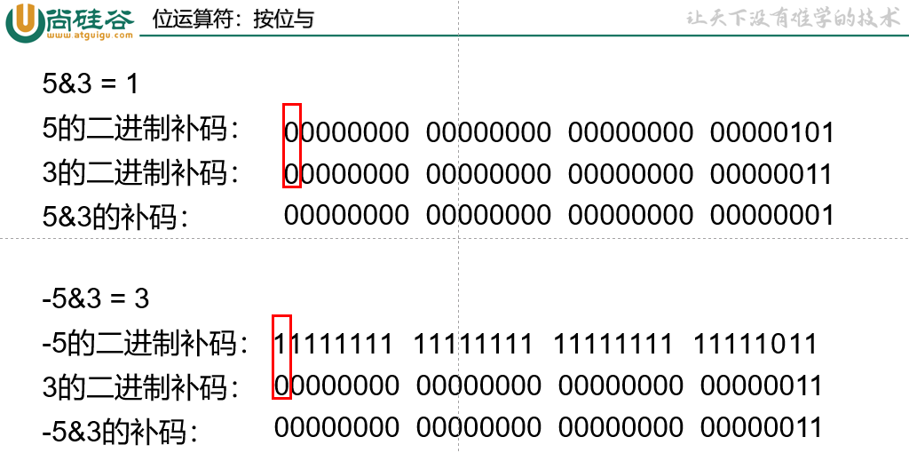 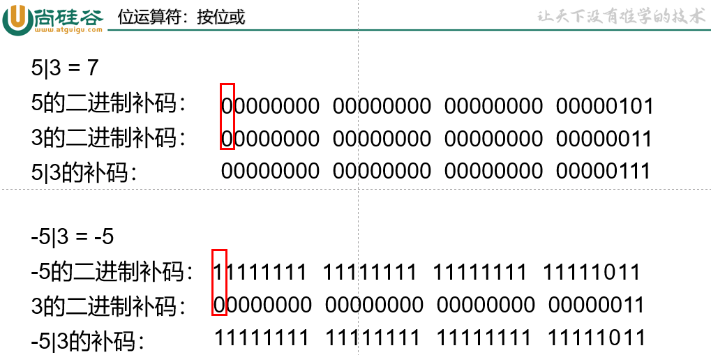 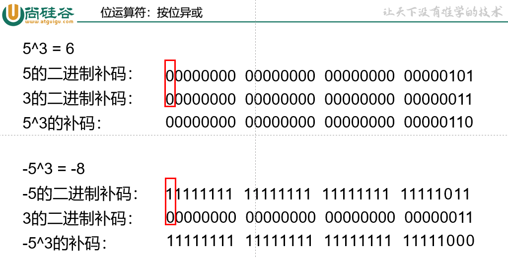

```java
public class TestBitLogic {
    public static void main(String[] args) {
        System.out.println( 5 & 3);
        /*
        5的二进制补码：00000000 00000000 00000000 00000101
        3的二进制补码：00000000 00000000 00000000 00000011
        5 & 3     :  00000000 00000000 00000000 00000001（十进制1）（都为1，才是1，如果有一个不是1，就是0）
        
         */

        System.out.println( 5 | 3);
        /*
        5的二进制补码：00000000 00000000 00000000 00000101
        3的二进制补码：00000000 00000000 00000000 00000011
        5 | 3     :  00000000 00000000 00000000 00000111（十进制7）（只要有一个是1，就是1）
         */

        System.out.println( 5 ^ 3);
        /*
        5的二进制补码：00000000 00000000 00000000 00000101
        3的二进制补码：00000000 00000000 00000000 00000011
        5 ^ 3     :  00000000 00000000 00000000 00000110（十进制6）（都为1，就是0，都是0还是0，其余是1）

         */


    }
}
```

### 3、一元运算符：按位取反

按位取反：~

规则：所有二进制位取反，包括符号位

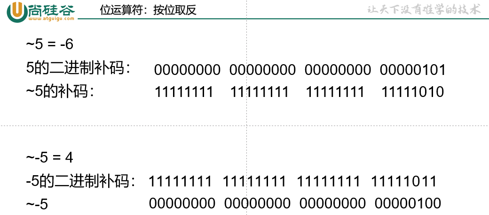

```java
public class TestBitNegation {
    public static void main(String[] args) {
        System.out.println(~5);
        /*
        5的二进制补码：       00000000 00000000 00000000 00000101
        逐位取反（包括符号位）：11111111 11111111 11111111 11111010（十进制-6）
         */
    }
}
```

## 1.3 运算符优先级

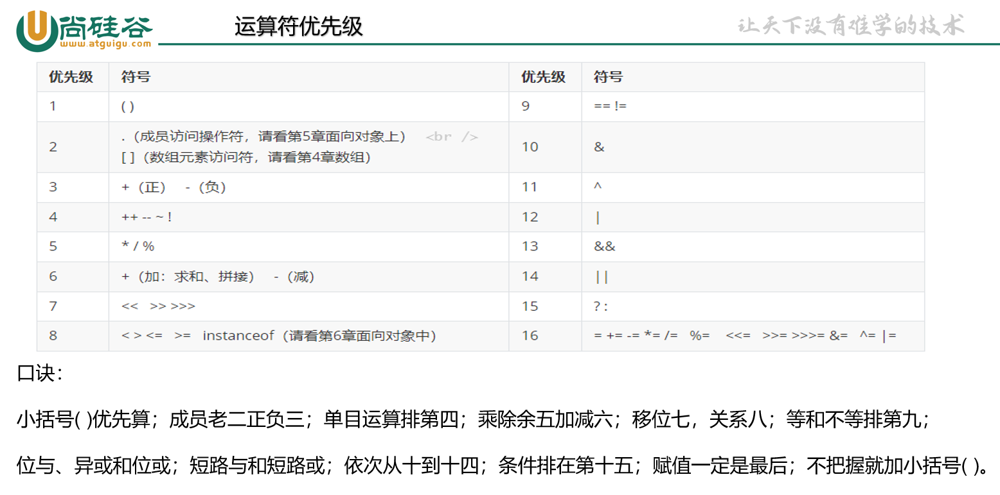

- 尽量不要写太复杂的表达式，如果计算比较复杂，那么分步骤写更好一些
- 如果自己写代码时不确定优先级，查表或者加()
- 大概记一些：一元运算符 > 算术 > 移位 > 比较 > 逻辑 > 条件 > 赋值

## 1.4 练习题

图片中的完整文本如下，方便直接复制：

## 10、位运算符基础练习

### 练习题 1: 位与 (&)

**题目：** 给定两个整数 `a = 4` 和 `b = 3`，计算 `a & b` 的结果。

### 练习题 2: 位或 (|)

**题目：** 给定两个整数 `x = 7` 和 `y = 2`，计算 `x | y` 的结果。

### 练习题 3: 位异或 (^)

**题目：** 给定两个整数 `m = 10` 和 `n = 4`，计算 `m ^ n` 的结果。

### 练习题 4: 按位取反 (~)

**题目：** 给定一个整数 `k = -8`，计算 `~k` 的结果。

### 练习题 5: 左移 (<<)

**题目：** 给定一个整数 `p = 3`，计算 `p << 2` 的结果。

### 练习题 6: 右移 (>>)

**题目：** 给定一个整数 `q = 16`，计算 `q >> 3` 的结果。

### 练习题 7: 无符号右移 (>>>)

**题目：** 给定一个整数 `r = -16`，计算 `r >>> 2` 的结果。

# 二、流程控制语句结构

流程：

- 包含按步骤做事情，先做什么后做什么
- 包含选择、重复

用程序控制流程就得用一些特定的语句结构，例如分支结构实现选择，循环结构实现重复。默认情况下，程序都是从上往下依次执行。

## 2.1 输出语句

### 1、输出xxx之后换行

```
System.out.println(); //代码的快捷模板 sout
```

### 2、输出xxx之后不换行

```java
System.out.print();
public class TestPrint {
    public static void main(String[] args) {
        System.out.println("hello");
        System.out.println("world");
        System.out.print("chai");
        System.out.print("lin");
        System.out.print("yan");

        System.out.println();//啥也不输出，只换行
       // System.out.print();//()里面不能空着，如果不输出内容，又不换行，这句话没有意义
    }
}
```

### 3、Debug演示

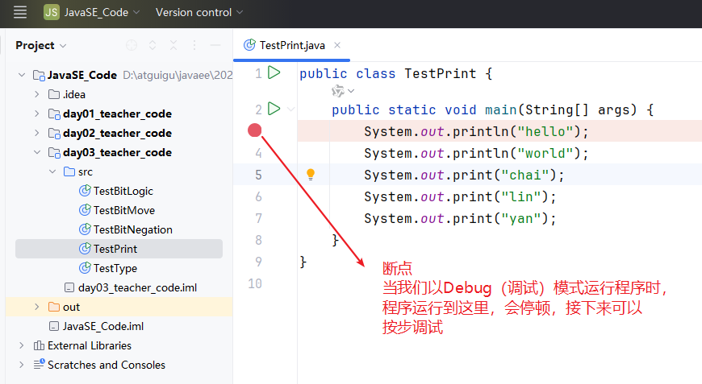

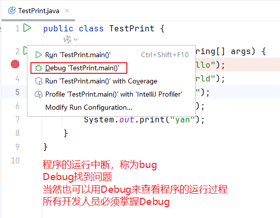

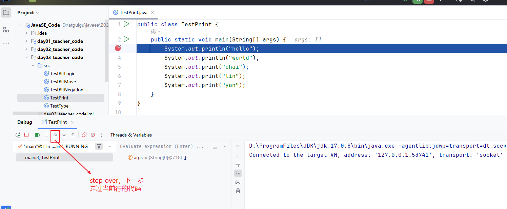

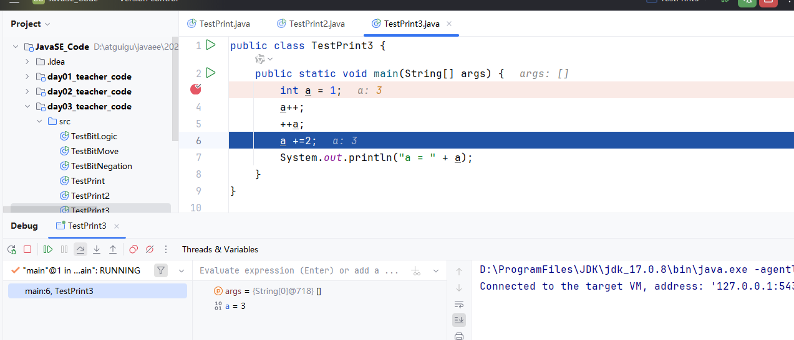

### 4、自定义快捷模板

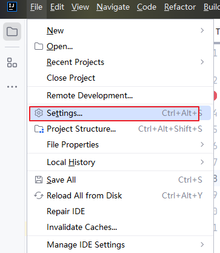 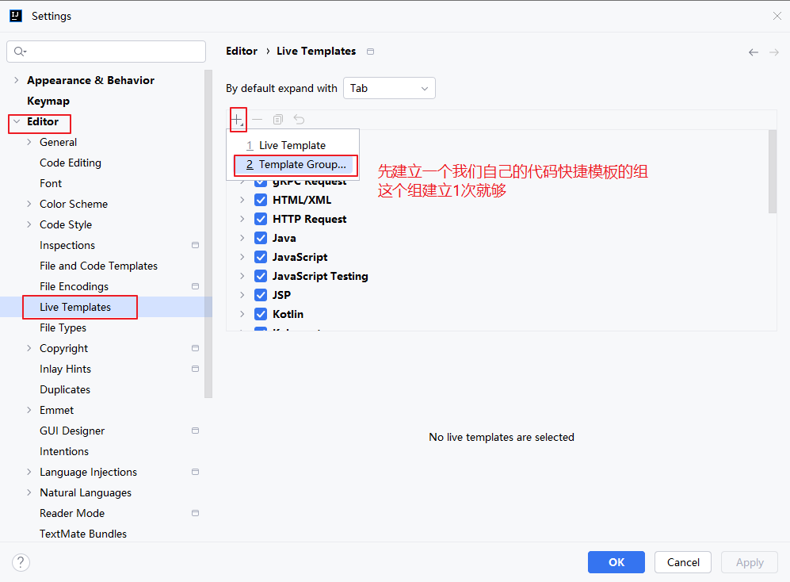 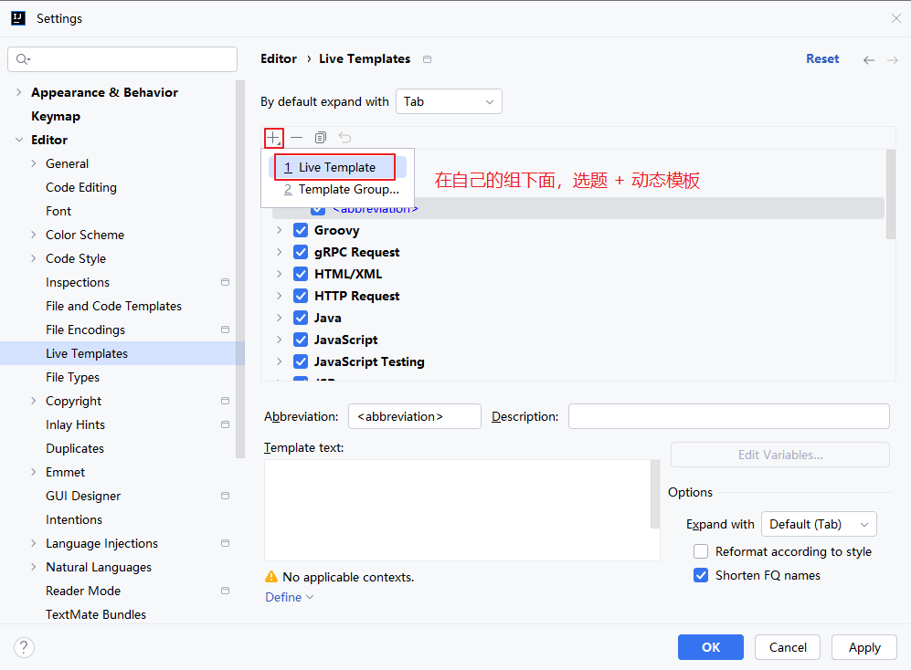 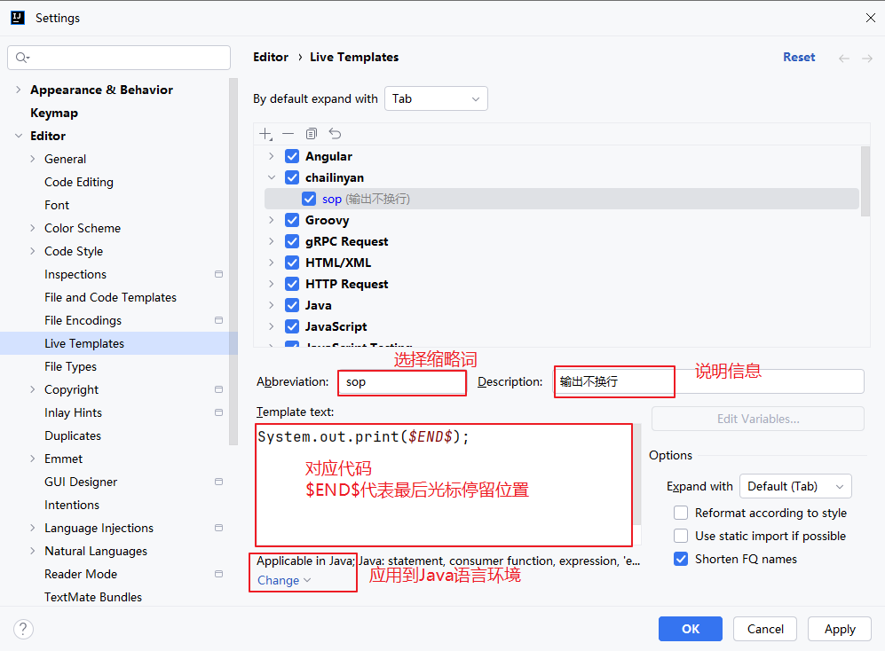 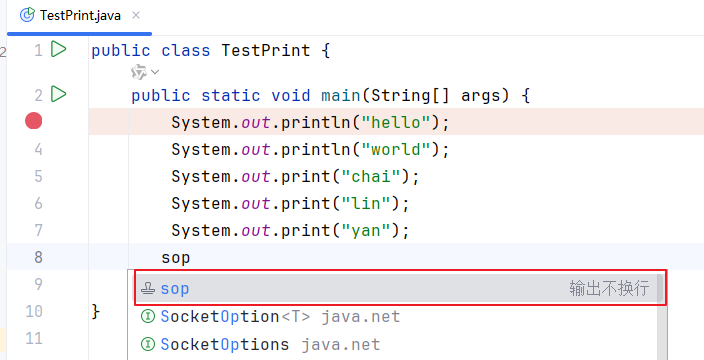

### 5、关于变量的输出

print()和println()里面都支持1个参数值，如果有多个数据需要在一个输出语句里面输出，必须把它们拼接（以字符串的形式拼接）起来。

```java
public class TestPrint2 {
    public static void main(String[] args) {
        int a = 1, b = 2;
        System.out.println(a + "," +  b);
        System.out.println("a = " + a + ",b = " + b);

        float f = 1.2F;
        double d = f;
        System.out.println(d);

        //拓展  f代表format，格式化
        System.out.printf("f=%.3f",d);

        String name = "chailinyan";
        int age = 18;
        double weight = 85.5;
        //%xx类似于占位符  不同类型的占位符不一样， 字符串%s，整数%d，小数%f
        System.out.printf("姓名:%s，年龄:%d，体重：%.1f",name, age, weight);

    }
}
```

## 2.2 输入语句

输入语句是用于在程序运行期间，从控制台接收数据到程序中使用。

输入语句需要用到后面章节的一些内容，大家先可以模仿使用，暂时忽略一些专门名词的含义。

### 2.2.1 步骤

第一步：先创建一个Scanner工具类的对象

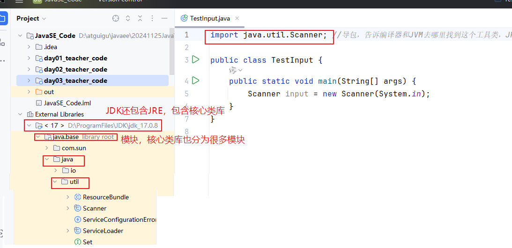

第二步：提示用户输入xx信息（建议大家写，界面更友好）

第三步：调用Scanner工具类的方法来从键盘接收数据，把这个数据赋值给合适类型的变量

第四步：建议大家关闭资源

```java
import java.util.Scanner; //导包，告诉编译器和JVM去哪里找到这个工具类，JRE中包含很多核心类库

public class TestInput {
    public static void main(String[] args) {
        /*
        这句代码创建了一个Scanner类的对象（这里忽略对象的概念）
        这句代码中只有input是可以变的，其余是固定的。
        input在这里就是一个变量名或对象名。它是标识符之一，可以由程序员自己取名字。
        这里取名为input，想要代表输入的意思

        System.in ：系统输入
        System.out：系统输出
         */

        Scanner input = new Scanner(System.in);

        System.out.print("请输入姓名：");

        /*
        调用Scanner工具类的方法来从键盘接收数据，把这个数据赋值给合适类型的变量
        调用，方法，都是新概念，先不管它
         */
        String name = input.next();

        System.out.print("请输入年龄：");
        int age = input.nextInt();

        System.out.print("请输入体重：");
        double weight = input.nextDouble();

        System.out.print("是否已婚（true/false）：");
        boolean marry = input.nextBoolean();

        System.out.print("请输入性别：");
//        char gender = input.nextChar();
        /*
        Scanner类在设计时考虑到使用String最多，所以输入String的方法，next()
        认为输入单个字符的情况很少，所以没有提供单独的nextChar()，
        如果你确实需要输入单个字符，那么可以从String中提取1个字符，
        charAt(index)，index=0,表示取第1个字符，这个index就是后面要学习的数组的下标概念
        charAt(index)，index=1,表示取第2个字符
        charAt(index)，index=2,表示取第3个字符
         */
        char gender = input.next().charAt(0);


        System.out.println("name = " + name);
        System.out.println("age = " + age);
        System.out.println("weight = " + weight);
        System.out.println("marry = " + marry);
        System.out.println("gender = " + gender);


        input.close();//释放资源，当前程序占用了键盘等系统资源，用完之后需要释放一下
    }
}
```

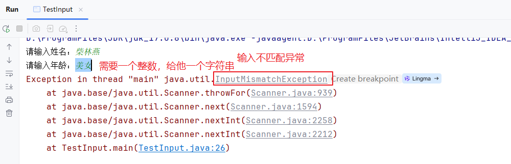

### 2.2.2 在一行输入多个值

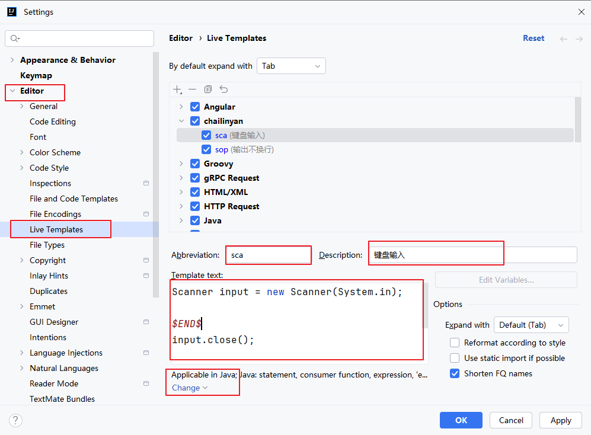


### 2.2.3 next()和nextLine()

- nextLine()方法，从读取数据的当前位置开始读取直到遇到换行符。读取时连同换行符一起读取，但是返回的结果中不包含换行符。

  ```java
  ⬆️hello world	回车换行
    hello world 回车换行⬇️
    
    // int age = input.nextInt();
    // 读取上面这部分，会从hello一直读到回车结束
    读取的内容：" hello world \n"
    返回的结果: " hello world"
      nextLine() 方法
  ```

  

- next()、nextInt()、nextDouble()等方法，从读取数据的当前位置开始找第一个非空格、换行等空白字符开始读取数据至下一个空格、换行等字符结束读取，读取时不读取换行符。

  ```java
  // next()
  ⬆️hello world 回车换行
    hello ⬆️ world 回车换行
    
    读取内容: " hello"
    返回的结果: "hello"
  
  // nextInt()
  ⬆️回车换行
   回车换行⬆️
   读取的内容: "\n"
   返回的结果: ""
   
  // next()
  ⬆️回车换行
  ⬆️回车换行
  读取的内容: ""
    
  // 
  ```

  

  next()方法

  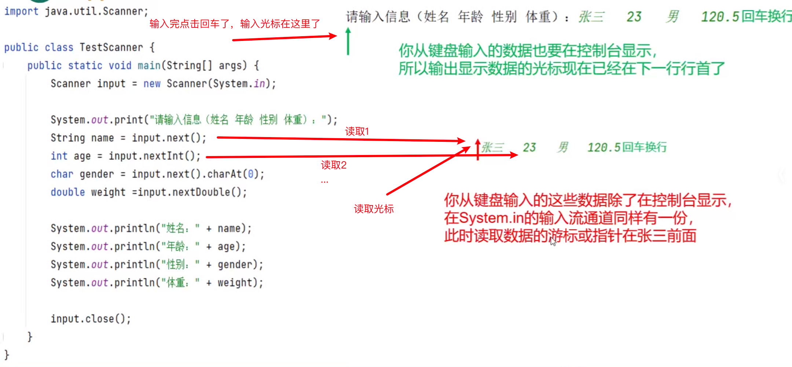

  nextLine()方法

  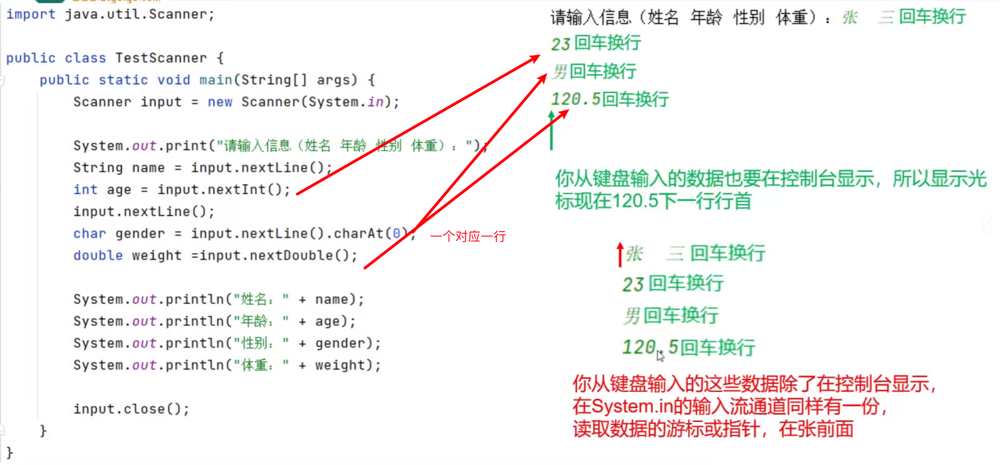

  nextLine读取的时候会读取换行，但是显示的时候不会显示换行

```java
import java.util.Scanner;

public class TestInput2 {
    public static void main(String[] args) {
        Scanner input = new Scanner(System.in);

        /*
        next()，nextInt()，nextDouble()，nextBoolean()等
        它们从控制台读取数据的规则是 从当前输入光标开始  往右找第1个非空格的字符开始读取，直到遇到空格、换行等空白字符位置。
        柴林燕              18  85.6  女

        next()从 柴前面开始读取，读取完柴林燕遇到空格就结束，光标停留在燕的后面
        nextInt()从燕的后面开始找第1个非空格的字符1开始读取，读完18遇到空格就结束，光标停留在8的后面
        nextDouble()从8的后面开始找第1个非空格的字符8开始读取，读完85.6遇到空格就结束，光标停留在6的后面
        next()从6的后面开始找第1个非空格的字符女开始读取，读完女遇到换行就结束，光标停留在女的后面
         */
        System.out.print("请输入姓名 年龄 体重 性别：");
        String name = input.next();
        int age = input.nextInt();
        double weight = input.nextDouble();
        char gender = input.next().charAt(0);

        System.out.println("name = " + name);
        System.out.println("age = " + age);
        System.out.println("weight = " + weight);
        System.out.println("gender = " + gender);

        input.close();
    }
}
```

暂时我们从控制台接收数据，不要用nextLine()方法。

```java
import java.util.Scanner;

public class TestInput3 {
    public static void main(String[] args) {
        Scanner input = new Scanner(System.in);

        /*
        next()，nextInt()，nextDouble()，nextBoolean()等
        它们从控制台读取数据的规则是 从当前输入光标开始  往右找第1个非空格的字符开始读取，直到遇到空格、换行等空白字符位置。
        nextLine()，从当前输入光标开始一直读取，包括空格，直到遇到回车换行为止
         */
        System.out.print("请输入姓名 年龄 体重 性别：");
        String name = input.nextLine();//小心
        int age = input.nextInt();
        double weight = input.nextDouble();
        char gender = input.next().charAt(0);

        System.out.println("name = " + name);
        System.out.println("age = " + age);
        System.out.println("weight = " + weight);
        System.out.println("gender = " + gender);

        input.close();
    }
}
```


## 2.3 分支语句之条件判断

### 2.3.1 单分支条件判断

```
if(条件表达式){
    语句块1;
}
```

当if条件成立，就执行语句块1，否则就不执行语句块1；

```java
import java.util.Scanner;

public class TestIf {
    public static void main(String[] args) {
        //定义一个变量，用于存储一年的总天数
        int days = 365;

        //从控制台读取键盘输入的年份值
        Scanner input = new Scanner(System.in);

        System.out.print("请输入年份：");
        int year = input.nextInt();

        //判断year是不是闰年，如果是闰年，请把days变量修改为366
        //(1)年份可以被4整除同时不被100整除（2）年份可以被400整除
        if(year % 4 == 0 && year % 100 != 0 || year % 400 == 0){
            days = 366;
        }

        //输出结果
        System.out.println(year +"年共有" + days + "天");
        
        input.close();
    }
}
```


### 2.3.2 双分支条件判断

```java
if(条件表达式){
    语句块1;
}else{
    语句块2;
}
```

当if条件成立，就执行语句块1，否则就执行语句块2；

```
import java.util.Scanner;

public class TestIfElse {
    public static void main(String[] args) {
        Scanner input = new Scanner(System.in);

        System.out.print("请输入一个整数：");
        int num = input.nextInt();

        /*if(num % 2 == 0){
            System.out.println(num + "是偶数");
        }
        if(num % 2 != 0){
            System.out.println(num +"是奇数");
        }*/

        if(num % 2 == 0){
            System.out.println(num + "是偶数");
        }else{
            System.out.println(num +"是奇数");
        }

        input.close();
    }
}
```

### 2.3.3 多分支条件判断

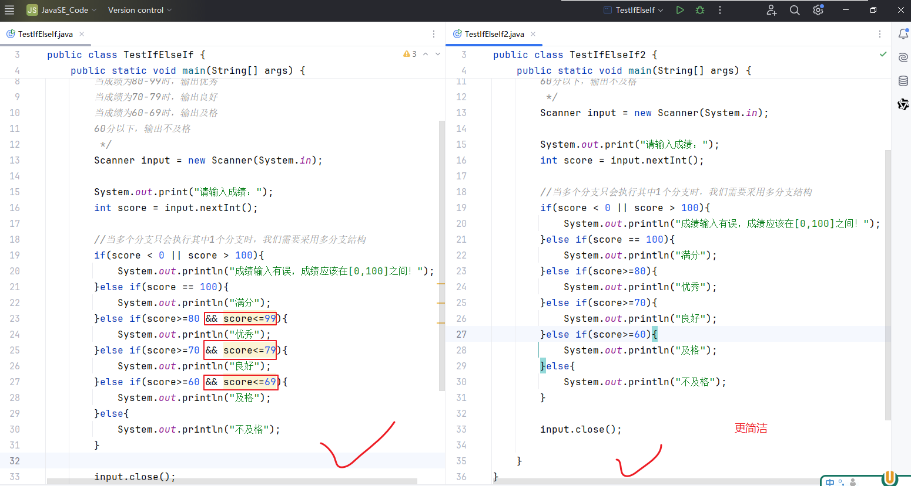

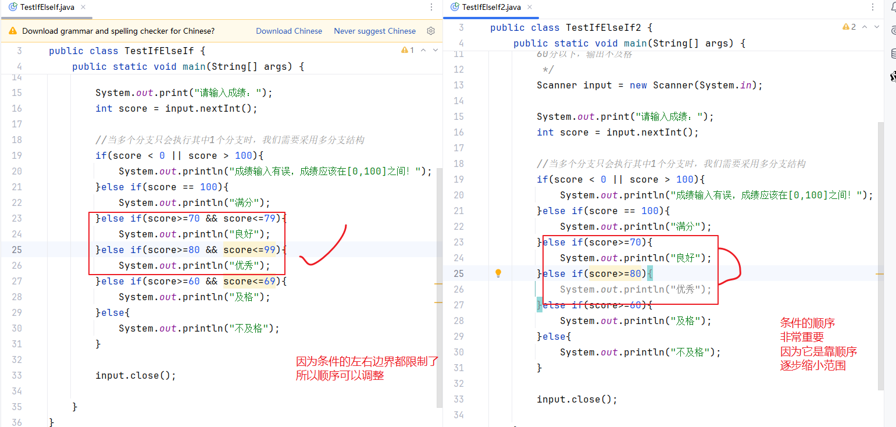

### 2.3.4 嵌套

```
import java.util.Scanner;

public class TestIfElseIf3 {
    public static void main(String[] args) {
        /*
        从控制台输入1个成绩，成绩应该在[0,100]之间
        当成绩为100分时，输出满分
        当成绩为80-99时，输出优秀
        当成绩为70-79时，输出良好
        当成绩为60-69时，输出及格
        60分以下，输出不及格
         */
        Scanner input = new Scanner(System.in);

        System.out.print("请输入成绩：");
        int score = input.nextInt();

        //当多个分支只会执行其中1个分支时，我们需要采用多分支结构
/*        if(score < 0 || score > 100){
            System.out.println("成绩输入有误，成绩应该在[0,100]之间！");
        }else{
            if(score == 100){
                System.out.println("满分");
            }else if(score>=70 && score<=79){
                System.out.println("良好");
            }else if(score>=80 && score<=99){
                System.out.println("优秀");
            }else if(score>=60 && score<=69){
                System.out.println("及格");
            }else{
                System.out.println("不及格");
            }
        }*/

        if(score>=0 && score<=100){
            if(score == 100){
                System.out.println("满分");
            }else if(score>=70 && score<=79){
                System.out.println("良好");
            }else if(score>=80 && score<=99){
                System.out.println("优秀");
            }else if(score>=60 && score<=69){
                System.out.println("及格");
            }else{
                System.out.println("不及格");
            }
        }else{
            System.out.println("成绩输入有误，成绩应该在[0,100]之间！");
        }

        input.close();

    }
}
```