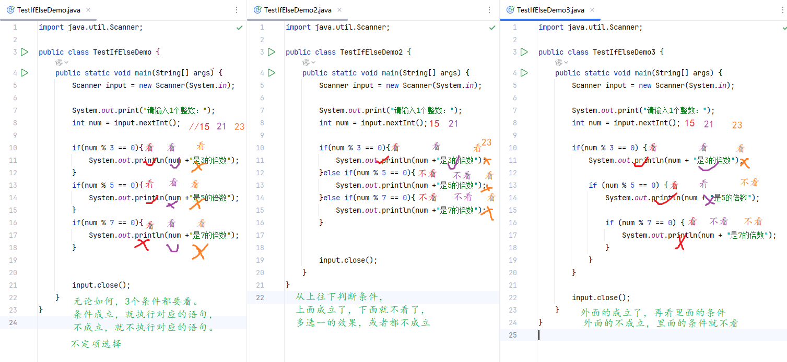
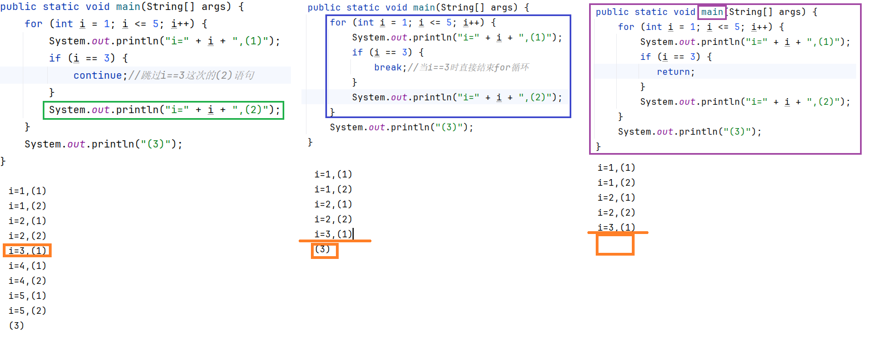

#  一、复习

## 1.1 位运算符

- 左移：<<
  - a << b，等价于 a * 2的b次方
  - 底层原理：a的补码整体往左移动，左边截断b位，右边补b个0
  - 可能出现符号位改变，0变1,1变0
- 右移：>>
  - a >> b，等价于 a / 2的b次方，呈现向下取整的效果
  - 底层原理：a的补码整体往右移动，右边截断b位，左边补b个0或1，原来最高位是0继续0，原来最高位是1继续补1
  - 不会出现改变符号位
- 无符号右移：>>>
  - 正数的>>> 和 >> 相同
  - 负数>>>的底层原理：a的补码整体往右移动，右边截断b位，左边补b个0,
  - 无论是正数还是负数，无符号右移完之后都是正数
- 按位与：&
  - a & b 底层原理：将a和b的补码对齐，逐位计算，1 & 1 为 1，其余为0
- 按位或：|
  - a | b 底层原理：将a和b的补码对齐，逐位计算，0 | 0 为 0，其余为1
- 按位异或：^
  - a ^ b 底层原理：将a和b的补码对齐，逐位计算，相同为0，不同为1
- 按位取反：~
  - ~a 底层原理：将a的补码所有位，包括符号位，全部取反，0变1,1变0
  - 注意，这里的区分规则 与 原码和反码转换不同，因为原码和反码的取反是不动符号位

## 1.2 输出语句

```
System.out.println();
System.out.println(值);
System.out.print(值);
```

## 1.3 输入语句

```
import java.util.Scanner;

public class Demo{
    public static void main(String[] args){
        Scanner xx = new Scanner(System.in);
        
        System.out.print("请输入*****：");
        String 变量名1 = xx.next();
        int 变量名2 = xx.nextInt();
        double 变量名3 = xx.nextDouble();
        boolean 变量名4 = xx.nextBoolean();
        char 变量名5 = xx.next().charAt(0);
        
        xx.close();
    }
}
```

## 1.4 条件判断

```
if(条件表达式){ //单分支条件判断
    语句块1;
}
if(条件表达式){ //双分支条件判断
    语句块1;
}else{
    语句块2;
}
if(条件表达式){ //多分支条件判断
    语句块1;
}else if(条件表达式){
    语句块2;
}else if(条件表达式){
    语句块3;
}【else{
    语句块4;
}】
    
    【】表示可选
```



# 二、流程控制语句结构（续）

## 2.1 选择结构（要求掌握）

### 2.2.1 传统的switch-case语句

```
switch(表达式){
    case 常量值1:
        语句块1;
    case 常量值2:
        语句块2;
    case 常量值3:
        语句块3;
    default:
        语句块n+1;
}
```

执行特点：

- 入口
  - case入口：优先考虑，switch(表达式)的值与某个常量值“相同”了，就从这个case进入
  - default入口：当所有case都不匹配时，就找default进入
- 出口：
  - 自然出口：从入口一直往下直到switch-case执行到底
  - 中断出口：遇到break
- 穿透性/贯穿性：
  - 无论你是从case进来，还是从default进入，只要没有遇到break，就会贯穿

switch-case有一些语法要求：

- switch(表达式)的值类型有限制，只支持 byte，short，int，char 四种基本数据类型，另外在JDK5支持枚举类型（后面再学习），JDK7支持String类型。
- case 后面必须跟常量值，不能是变量。
- case 后面的常量值不能重复。

```
import java.util.Scanner;

public class TestSwitchCase {
    public static void main(String[] args) {
        //从控制台接收用户输入的星期值[1,7]，然后输出它对应的英文单词
        Scanner input = new Scanner(System.in);

        System.out.print("请输入星期值[1,7]：");
        int week = input.nextInt();
        
        switch (week){
            case 1:
                System.out.println("Monday");
                break;
            case 2:
                System.out.println("Tuesday");
                break;
            case 3:
                System.out.println("Wednesday");
                break;
            case 4:
                System.out.println("Thursday");
                break;
            case 5:
                System.out.println("Friday");
                break;
            case 6:
                System.out.println("Saturday");
                break;
            case 7:
                System.out.println("Sunday");
                break;
            default:
                System.out.println("星期输入有误");
                break;
        }
        input.close();
    }
}
```

### 2.2.2 传统的switch-case语句与if-else有什么区别

- 适用性：if-else适用性更广，可以用switch-case的地方都可以改用if-else来实现
- 效率：switch-case的条件判断的效率更高
- 穿透性：某些场景下switch-case的穿透性可以简化代码，if-else没有穿透性

```
import java.util.Scanner;

public class TestSwitchCase2 {
    public static void main(String[] args) {
        /*
        从控制台接收用户输入的年、月、日，然后计算这一天是这一年的第几天，
        例如：输入的是2024-11-6
        (1)计算1-10月的满月天数
        (2)加11月的6天
         */
        Scanner input = new Scanner(System.in);

        System.out.print("请输入年 月 日：");
        int year = input.nextInt();
        int month = input.nextInt();
        int day = input.nextInt();

        //定义一个变量，用来存总天数
        int days = 0;

        //先计算[1, month-1]月的满月天数
        /*if(month==2){
            days += 31;//1月的满月天数
        }else if(month == 3){
            days += 31 + (year%4==0 && year%100!=0 || year%400==0 ? 29 : 28);//1,2月总天数
        }else if(month == 4){
            days += 31 + (year%4==0 && year%100!=0 || year%400==0 ? 29 : 28) + 31;//1,2,3月总天数
        }//这么写比较麻烦*/
        switch (month){
            case 12:
                days += 30;//11月的满月天数
            case 11:
                days += 31;//10月的满月天数
            case 10:
                days += 30;//9月的满月天数
            case 9:
                days += 31;//8月的满月天数
             case 8:
                days += 31;//7月的满月天数
            case 7:
                days += 30;//6月的满月天数
            case 6:
                days += 31;//5月的满月天数
            case 5:
                days += 30;//4月的满月天数
            case 4:
                days += 31;//3月的满月天数
            case 3:
                days += year%4==0 && year%100!=0 || year%400==0 ? 29 : 28;//2月的满月天数
            case 2:
                days += 31;//1月的满月天数
            case 1:
                days += day;
        }
        System.out.println(year +"年" + month +"月" + day + "日是这一年的第" + days +"天");

        input.close();
    }
}
```

### 2.2.3 switch表达式

这个新特性在JDK17版本可以正常使用，在JDK8，11及其之前版本是无法使用的。

|                                        | 传统的switch-case语句结构 | switch表达式     |
| -------------------------------------- | ------------------------- | ---------------- |
| case后面的标点符号                     | :                         | ->               |
| 穿透性                                 | 有                        | 没有             |
| 是否可以作为表达式给变量赋值           | 不可以                    | 可以             |
| case后面如果要写`多个语句`是否必须加{} | 不需要                    | 强制要求         |
| default分支是否必选                    | 可选                      | 作为表达式是必选 |

#### 案例1

```
import java.util.Scanner;

public class TestSwitchExpression {
    public static void main(String[] args) {
        //从控制台接收用户输入的星期值[1,7]，然后输出它对应的英文单词
        Scanner input = new Scanner(System.in);

        System.out.print("请输入星期值[1,7]：");
        int week = input.nextInt();

        switch (week) {
            case 1 -> System.out.println("Monday");
            case 2 -> System.out.println("Tuesday");
            case 3 -> System.out.println("Wednesday");
            case 4 -> System.out.println("Thursday");
            case 5 -> System.out.println("Friday");
            case 6 -> System.out.println("Saturday");
            case 7 -> System.out.println("Sunday");
            default -> System.out.println("星期输入有误"); //可选
        }

        input.close();
    }
}
```

#### 案例2

```
import java.util.Scanner;

public class TestSwitchExpression2 {
    public static void main(String[] args) {
        //从控制台接收用户输入的星期值[1,7]，然后输出它对应的英文单词
        Scanner input = new Scanner(System.in);

        System.out.print("请输入星期值[1,7]：");
        int week = input.nextInt();

        String weekName = switch (week) {
            case 1 -> "Monday";
            case 2 -> "Tuesday";
            case 3 -> "Wednesday";
            case 4 -> "Thursday";
            case 5 -> "Friday";
            case 6 -> "Saturday";
            case 7 -> "Sunday";
            default -> "星期输入有误";//必选
        };
        System.out.println("weekName = " + weekName);

        input.close();
    }
}
```

#### 案例3

```
import java.util.Scanner;

public class TestSwitchExpression3 {
    public static void main(String[] args) {
        //从控制台接收用户输入的星期值[1,7]，然后输出它对应的英文单词
        Scanner input = new Scanner(System.in);

        System.out.print("请输入星期值[1,7]：");
        int week = input.nextInt();

        String weekName = switch (week) {
            case 1 -> "Monday";
            case 2 -> "Tuesday";
            case 3 -> "Wednesday";
            case 4 -> "Thursday";
            case 5 -> "Friday";
            case 6 -> "Saturday";
            case 7 -> {
                System.out.println("这一天是我最喜欢的一天！");
                yield "Sunday";//yield是一个上下文关键字，只在switch表达式的内部是关键字，在其他地方是普通单词
            }
            default -> "星期输入有误"; //必选
        };
        System.out.println("weekName = " + weekName);

        input.close();
    }
}
```

### 2.2.4 练习题

```
import java.util.Scanner;

public class SwitchExercise2 {
    public static void main(String[] args) {
        /*
        赌数游戏：随机产生3个1-6的整数，如果三个数相等，那么称为“豹子”，如果三个数之和大于9，称为“大”，
        如果三个数之和小于等于9，称为“小”，用户从键盘输入押的是“豹子”、“大”、“小”，并判断是否猜对了
         */

        //随机产生3个1-6的整数
        //方式一：Math.random() 产生[a,b)的整数 (int)(Math.random()*(b-a) + a)
        //方式二：Random工具类的nextInt(a,b)
        int x = (int)(Math.random() * (7-1) + 1);
        int y = (int)(Math.random() * (7-1) + 1);
        int z = (int)(Math.random() * (7-1) + 1);

/*        Random random = new Random();
        int x = random.nextInt(1,7);
        int y = random.nextInt(1,7);
        int z = random.nextInt(1,7);*/

        System.out.println("x = " + x);
        System.out.println("y = " + y);
        System.out.println("z = " + z);

        Scanner input = new Scanner(System.in);
        System.out.print("请押宝（豹子、大、小）:");
        String guess = input.next();
        System.out.println("guess = " + guess);

        String randStr = "";
        if(x == y && y == z){
            randStr = "豹子";
        }else if(x + y + z > 9){
            randStr = "大";
        }else{
            randStr = "小";
        }
        System.out.println("randStr = " + randStr);

        /*if(guess == randStr){//对于字符串来说，不能用==字符串的内容，因为字符串不是基本数据类型
            System.out.println("猜对了");
        }else{
            System.out.println("猜错了");
        }*/
        if(guess.equals(randStr)){
            System.out.println("猜对了");
        }else{
            System.out.println("猜错了");
        }

        input.close();
    }
}
import java.util.Scanner;

public class SwitchExercise2_2 {
    public static void main(String[] args) {
        /*
        赌数游戏：随机产生3个1-6的整数，如果三个数相等，那么称为“豹子”，如果三个数之和大于9，称为“大”，
        如果三个数之和小于等于9，称为“小”，用户从键盘输入押的是“豹子”、“大”、“小”，并判断是否猜对了
         */

        //随机产生3个1-6的整数
        //方式一：Math.random() 产生[a,b)的整数 (int)(Math.random()*(b-a) + a)
        //方式二：Random工具类的nextInt(a,b)
        int x = (int)(Math.random() * (7-1) + 1);
        int y = (int)(Math.random() * (7-1) + 1);
        int z = (int)(Math.random() * (7-1) + 1);

/*        Random random = new Random();
        int x = random.nextInt(1,7);
        int y = random.nextInt(1,7);
        int z = random.nextInt(1,7);*/

        System.out.println("x = " + x);
        System.out.println("y = " + y);
        System.out.println("z = " + z);

        Scanner input = new Scanner(System.in);
        System.out.print("请押宝（豹子、大、小）:");
        String guess = input.next();

        switch (guess){
            case "豹子":
                System.out.println(x == y && y == z ? "猜对了" : "猜错了" );
                break;
            case "大":
                System.out.println(x + y + z > 9 ? "猜对了" : "猜错了");
                break;
            case "小":
                System.out.println(x + y + z <= 9 ? "猜对了" : "猜错了");
                break;
            default:
                System.out.println("输入有误！");
        }

        input.close();
    }
}
import java.util.Scanner;

public class SwitchExercise2_3 {
    public static void main(String[] args) {
        /*
        赌数游戏：随机产生3个1-6的整数，如果三个数相等，那么称为“豹子”，如果三个数之和大于9，称为“大”，
        如果三个数之和小于等于9，称为“小”，用户从键盘输入押的是“豹子”、“大”、“小”，并判断是否猜对了
         */

        //随机产生3个1-6的整数
        //方式一：Math.random() 产生[a,b)的整数 (int)(Math.random()*(b-a) + a)
        //方式二：Random工具类的nextInt(a,b)
        int x = (int) (Math.random() * (7 - 1) + 1);
        int y = (int) (Math.random() * (7 - 1) + 1);
        int z = (int) (Math.random() * (7 - 1) + 1);

/*        Random random = new Random();
        int x = random.nextInt(1,7);
        int y = random.nextInt(1,7);
        int z = random.nextInt(1,7);*/

        System.out.println("x = " + x);
        System.out.println("y = " + y);
        System.out.println("z = " + z);

        Scanner input = new Scanner(System.in);
        System.out.print("请押宝（豹子、大、小）:");
        String guess = input.next();

        boolean result = switch (guess) {
            case "豹子" -> x == y && y == z;
            case "大" -> x + y + z > 9;
            case "小" -> x + y + z <= 9;
            default -> false;
        };

        System.out.println(result ? "猜对了" : "猜错了");

        input.close();
    }
}
```

## 2.2 循环结构

循环结构的作用是`重复`执行某些代码。

循环结构有3种：for、while、do-while。

### 2.2.1 for循环（要求必须掌握）

语法结构：

```
for(①循环变量初始化表达式; ②循环条件表达式; ③迭代表达式){
    ④循环体语句块;
}
```

执行过程：①②成立④③ ②成立④③ ②成立④③ ②成立④③ … ②不成立

注意事项：

- for()里面两个分号不能多也不能少
- 循环条件表达式的位置②，必须是一个boolean值表达式
- for循环的条件有可能一次都不成立，循环体语句④一次都不执行

#### 案例1

```
public class TestFor1 {
    public static void main(String[] args) {
/*        for(;;) {//是循环，但是它是死循环，无限循环，通常是需要我们避免的
            System.out.println("我爱尚硅谷");
        }*/

        /*for(int i=1; i<=5; i++){
            System.out.println("我爱尚硅谷" + i);
        }*/
        /*
        int i=1; i<=5; 成立 System.out.println("我爱尚硅谷");
        i++; i=2; i<=5; 成立 System.out.println("我爱尚硅谷");
        i++; i=3; i<=5; 成立 System.out.println("我爱尚硅谷");
        i++; i=4; i<=5; 成立 System.out.println("我爱尚硅谷");
        i++; i=5; i<=5; 成立 System.out.println("我爱尚硅谷");
        i++; i=6; i<=5; 不成立，结束for
         */
        /*int i;
        for(i=1; i<=5; i++){
            System.out.println("我爱尚硅谷" + i);
        }
        System.out.println("i = " + i);*/


        for(int i=1; i>=5; i++){
            System.out.println("我爱尚硅谷" + i);
        }
        //int i=1; i>=5; 不成立 
    }
}
```

#### 案例2

```
public class TestFor2 {
    public static void main(String[] args) {
        //使用for循环，实现求1-100的整数和
        int sum = 0;
        for(int i=1; i<=100; i++){
            sum += i;
        }
        System.out.println("sum = " + sum);
    }
}
```

#### 练习题1

```
public class ForExercise1 {
    public static void main(String[] args) {
        //题1：输出1-100的偶数
        //方式一：用if条件控制某些语句
        for(int i=1; i<=100; i++){//数字范围是[1,100]所有数
            if (i%2==0) {//满足偶数条件的情况
                System.out.println(i);
            }
        }

        //方式二：控制循环的次数是50次，以及参与循环的全部是偶数，非偶数不参与循环
        /*for(int i=2; i<=100; i+=2){
            System.out.println(i);
        }*/

        //写代码：先完成，再完美
    }
}
```

#### 练习题2

```
public class ForExercise2 {
    public static void main(String[] args) {
        //2、所谓水仙花数是指一个3位数，其各个位上数字立方和等于其本身。
        // 例如： 153 = 1*1*1 + 5*5*5 + 3*3*3，
        // 找出所有的水仙花数，并统计他们有几个。
/*
这道题需要注意的：
（1）百位、十位、个位的求法，运算符的应用
（2）变量和语句是不是应该在循环中，
放到循环for的{}一定是需要重复，反复执行的语句
 */

        //水仙花数是指一个3位数 => 循环的范围 [100, 999]
        int count = 0;
        for(int i=100; i<=999; i++){
            //求各个位上数字，百位、十位、个位
            int bai = i / 100;
//            int shi = i / 10 % 10;
            int shi = i % 100 / 10;
            int ge = i % 10;


    /*        System.out.println("bai = " + bai);
            System.out.println("shi = " + shi);
            System.out.println("ge = " + ge);*/

            if(bai * bai * bai + shi * shi *shi + ge * ge * ge == i){
                System.out.println(i);
                count++;

            }

        }

        System.out.println("一共有：" + count);
    }
}
/*
学习基础有两个目标：
1、基本语法（死的规定）
2、编程思维的锻炼
 */
```

#### 练习题3

```
public class ForExercise3 {
    public static void main(String[] args) {
        //3、从1循环到150并在每行打印一个值，另外在每个3的倍数行上打印出“foo”,
        // 在每个5的倍数行上打印“biz”,在每个7的倍数行上打印输出“baz”。

        for(int i=1; i<=150; i++){ //这里写i++或++i或i+=1或i=i+1都可以
            System.out.print(i);
            if(i%3==0){
                System.out.print("\tfoo");
            }
            if(i%5==0){
                System.out.print("\tbiz");
            }
            if(i%7==0){
                System.out.print("\tbaz");
            }
            System.out.println();
        }
    }
}
public class ForExercise3_2 {
    public static void main(String[] args) {
        //3、从1循环到150并在每行打印一个值，另外在每个3的倍数行上打印出“foo”,
        // 在每个5的倍数行上打印“biz”,在每个7的倍数行上打印输出“baz”。

        /*for(int i=1; i<=150; i++){ //这里写i++或++i或i+=1或i=i+1都可以
            String str = "" + i;//""空字符串
            if(i%3==0){
                str += "\tfoo";
            }
            if(i%5==0){
                str += "\tbiz";
            }
            if(i%7==0){
                str += "\tbaz";
            }
            System.out.println(str);
        }*/

        for (int i = 1; i <= 150; i++) { //这里写i++或++i或i+=1或i=i+1都可以
            String str = "" + i;//""空字符串
            str += i % 3 == 0 ? "\tfoo" : "";
            str += i % 5 == 0 ? "\tbiz" : "";
            str += i % 7 == 0 ? "\tbaz" : "";
            System.out.println(str);
        }
    }
}
```

#### 练习题4

```
import java.util.Scanner;

public class ForExercise4 {
    public static void main(String[] args) {
        Scanner input = new Scanner(System.in);
        double balance = 0.0; //余额
        boolean flag = true;//标记法
        for(; flag ;){
            System.out.println("=========ATM========");
            System.out.println("\t\t1.存款");
            System.out.println("\t\t2.取款");
            System.out.println("\t\t3.查询余额");
            System.out.println("\t\t4.退出");
            System.out.print("请选择：");
            int select = input.nextInt();

            switch (select){
                case 1 ->{
                    System.out.print("请输入存款金额：");
                    double money = input.nextDouble();
                    balance += money;
                }
                case 2 -> {
                    System.out.print("请输入取款金额：");
                    double money = input.nextDouble();
                    balance -= money;
                }
                case 3 -> System.out.println("余额：" + balance);
                case 4 -> flag = false;
                default -> System.out.println("输入有误！");
            }

        }
        input.close();
    }
}
```

### 2.2.2 while循环（要求掌握）

语法结构：

```
while(①循环条件表达式){
    ②循环体语句;
}
```

执行特点：①成立②①成立②①成立②①成立②①成立②…①不成立

有可能出现 ①不成立，循环体②一次都不执行的情况。

```
public class TestWhile {
    public static void main(String[] args) {
        //输出5次我爱尚硅谷
        int i= 1;
        while(i<=5){
            System.out.println("我爱尚硅谷" + i);
            i++;
        }
        System.out.println("i = " + i);
    }
}
```

### 2.2.3 do-while循环（了解）

语法结构：

```
do{
    ②循环体语句;
}while(①循环条件表达式);
```

执行特点：②①成立②①成立②①成立②①成立②…①不成立

无论如何，循环体②一定会执行1次，至少执行1次。

```
public class TestDoWhile {
    public static void main(String[] args) {
        //输出5次我爱尚硅谷
        int i= 1;
        do{
            System.out.println("我爱尚硅谷" + i);
            i++;
        }while(i<=5);
        System.out.println("i = " + i);
    }
}
```

### 2.2.4 三种循环如何选择

首先，三种循环的作用是相同的，完全可以互换。

但是，习惯上，

- 如果循环次数比较明显，通常用for。
- 如果循环体语句至少执行1次，先考虑do-while。
- 如果循环条件清晰，但是次数不明确，考虑用while。

#### 案例1

```
public class TestLoop {
    public static void main(String[] args) {
        //从1开始累加整数，1+2+3....，求使得累加和到达或超过100的最小n值
/*        int n = 1;
        int sum = 0;
        while(sum < 100){
            sum += n;
            n++;
        }
        System.out.println("sum = " + sum);
        System.out.println("最小n值：" + (n-1));*/

        System.out.println("=================");

        /*int sum = 0;
        int n;
        for(n = 1; sum < 100; n++){
            sum += n;
        }
        System.out.println("sum = " + sum);
        System.out.println("最小n值：" + (n-1));*/

        System.out.println("===============");
        int n = 1;
        int sum = 0;
        do{
            sum += n;
            n++;
        }while(sum < 100);
        System.out.println("sum = " + sum);
        System.out.println("最小n值：" + (n-1));
    }
}
```

#### 案例2

```
import java.util.Scanner;

public class TestLoop2 {
    public static void main(String[] args) {
        //随机产生1个[0,100)的整数，然后你来猜
        //如果猜的数 大于 随机产生的数，提醒玩家，猜大了
        //如果猜的数 小于 随机产生的数，提醒玩家，猜小了
        //如果猜的数 小于 随机产生的数，恭喜猜中了

        int randNum = (int)(Math.random()*100);
        Scanner input = new Scanner(System.in);

        //至少猜1次
/*        int num;
        do{
            System.out.print("请猜：");
            num = input.nextInt();

            if(num > randNum){
                System.out.println("猜大了");
            }else if(num < randNum){
                System.out.println("猜小了");
            }else{
                System.out.println("猜中了");
            }
        }while(num != randNum);*/

       /* int num = -1;//这里初始化为-1，是为了让第一次while循环成立
        while(num != randNum){
            System.out.print("请猜：");
            num = input.nextInt();

            if(num > randNum){
                System.out.println("猜大了");
            }else if(num < randNum){
                System.out.println("猜小了");
            }else{
                System.out.println("猜中了");
            }
        }*/

        for( int num = -1; num != randNum; ){
            System.out.print("请猜：");
            num = input.nextInt();

            if(num > randNum){
                System.out.println("猜大了");
            }else if(num < randNum){
                System.out.println("猜小了");
            }else{
                System.out.println("猜中了");
            }
        }

        input.close();
    }
}
```

## 2.3 跳转语句

|          | break                                    | continue                     | return           |
| -------- | ---------------------------------------- | ---------------------------- | ---------------- |
| 使用位置 | switch-case，循环结构                    | 循环结构                     | 方法体中任意位置 |
| 作用     | 用于结束/跳出当前的switch-case或循环结构 | 用于跳过本次循环体剩下的语句 | 用于结束当前方法 |



#### 案例1

```
public class TestBreakContinueReturn {
    public static void main(String[] args) {
        for (int i = 1; i <= 5; i++) {
            System.out.println("i=" + i + ",(1)");
            if (i == 3) {
                continue;//跳过i==3这次的(2)语句
            }
            System.out.println("i=" + i + ",(2)");
        }
        System.out.println("(3)");
    }
}
```

#### 案例2

```
public class TestBreakContinueReturn2 {
    public static void main(String[] args) {
        for (int i = 1; i <= 5; i++) {
            System.out.println("i=" + i + ",(1)");
            if (i == 3) {
                break;//当i==3时直接结束for循环
            }
            System.out.println("i=" + i + ",(2)");
        }
        System.out.println("(3)");
    }
}
```

#### 案例3

```
public class TestBreakContinueReturn3 {
    public static void main(String[] args) {
        for (int i = 1; i <= 5; i++) {
            System.out.println("i=" + i + ",(1)");
            if (i == 3) {
               return;
            }
            System.out.println("i=" + i + ",(2)");
        }
        System.out.println("(3)");
    }
}
```

#### 案例4

```
import java.util.Scanner;

public class TestPrimeNumber {
    public static void main(String[] args) {
        //从控制台接收一个整数，判断它是不是素数
        //什么是素数？也叫质数，它是大于1的自然数，并且只能被1和他本身整数
        //例如：7是素数
        Scanner input = new Scanner(System.in);

        System.out.print("请输入一个整数：");
        int num = input.nextInt();

        //思考：怎么在[2,num-1]范围内找num的约数，
        // 如果找到1个约数，num就不是素数
        /*for(int i=2; i<num; i++) {
            if (num%i==0) {//i是num的约数
                System.out.println(num + "不是素数");
                break;
            } else {
                System.out.println(num + "是素数");
            }
        }*/
        /*
        上面的代码是错误的，原因是：
            在[2, num-1]范围内找到任意1个num的约数，确实可以断定num不是素数。
            但是不能因为某一个i不是num的约数，就说num是素数
         */
        boolean flag = true;//这里true的意思，是假设num是素数
        for(int i=2; i<num; i++) {
            if(num%i==0){//i是num的约数
                flag = false;
                break;
            }
        }
        if (flag) {
            System.out.println(num + "是素数");
        } else {
            System.out.println(num + "不是素数");
        }

        input.close();
    }
}
import java.util.Scanner;

public class TestPrimeNumber2 {
    public static void main(String[] args) {
        //从控制台接收一个整数，判断它是不是素数
        //什么是素数？也叫质数，它是大于1的自然数，并且只能被1和他本身整数
        //例如：7是素数
        Scanner input = new Scanner(System.in);

        System.out.print("请输入一个整数：");
        int num = input.nextInt();

        //思考：怎么在[2,num-1]范围内找num的约数，
        // 如果找到1个约数，num就不是素数
        int i;
        for(i=2; i<num; i++) {
            if(num%i==0){//i是num的约数
                break;
            }
        }
        if (i==num) {
            System.out.println(num + "是素数");
        } else {
            System.out.println(num + "不是素数");
        }

        input.close();
    }
}
```

## 2.4 循环嵌套

原则：外循环循环一次，内循环需要走一轮。比喻：外循环相当于时针，内循环相当于分针。

#### 案例1

```
public class TestLoopInLoop1 {
    public static void main(String[] args) {
        /*
        1 1 1 1 1
        2 2 2 2 2
        3 3 3 3 3
        4 4 4 4 4
         */
        for(int i=1; i<=4; i++){//控制行数
//            5次的i值的打印
            for(int j=1; j<=5; j++){//控制5次的i值的打印
                System.out.print(i+" ");
            }
            System.out.println();//换行
        }
    }
}
```

#### 案例2

```
public class TestLoopInLoop2 {
    public static void main(String[] args) {
        for(int hour = 0; hour<24; hour++){
            for(int minute = 0; minute<60; minute++){
                System.out.println(hour +":" + minute);
            }
        }
    }
}
```

#### 案例3

```
public class TestLoopInLoop3 {
    public static void main(String[] args) {
        /*

        *
        * *
        * * *
        * * * *
        * * * * *

         */
        for(int i=1; i<=5; i++){
            /*
            i=1，需要打印1个*
            i=2，需要打印2个*
            ...
            i=5，需要打印5个*
             */
            for(int j=1; j<=i; j++){
                System.out.print("* ");
            }
            System.out.println();
        }
    }
}
```

#### 案例4

```
public class TestLoopInLoop4 {
    public static void main(String[] args) {
        /*
            *
           ***
          *****
         *******
        *********
         */
        for(int i=1; i<=5; i++){
            //打印空格
            /*
            当i=1，打印4个空格
            当i=2，打印3个空格
            当i=3，打印2个空格
            当i=4，打印1个空格
            当i=5，打印0个空格
             */
            for(int j=1; j<=5-i; j++){
                System.out.print("  ");
            }
            /*
            //打印*
            i=1，需要打印1个*
            i=2，需要打印3个*
            i=3，需要打印5个*
            i=4，需要打印7个*
            i=5，需要打印9个*
             */
            for(int j=1; j<=2*i - 1; j++){
                System.out.print("* ");
            }
            //换行
            System.out.println();
        }
    }
}
```