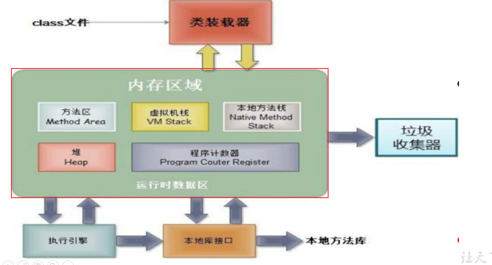
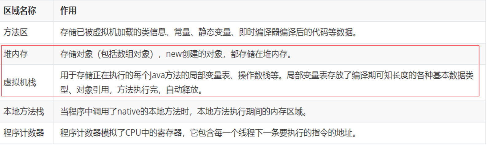
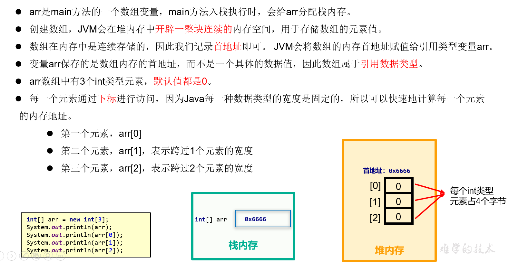
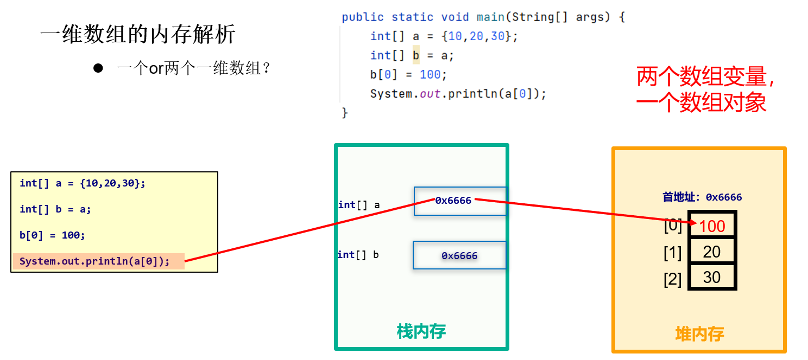
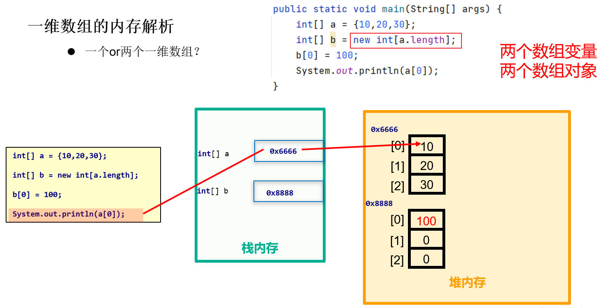
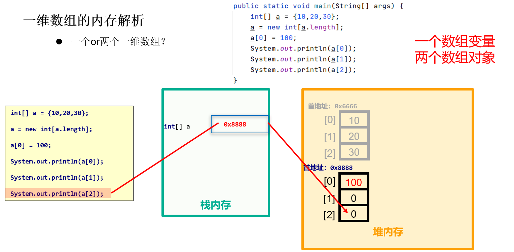
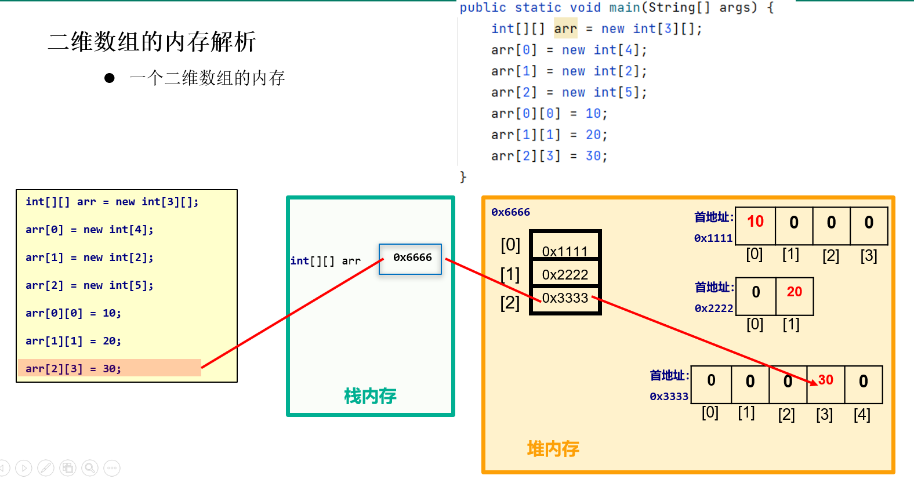

#  一、数组（`非常重要`）

## 1.1 基本概念（会区分）

数组的标志性符号：[]

数组(array)是用来管理一组相同数据类型的变量/数据的容器/结构。这组相同数据类型的变量，使用一个统一的名称，称为`数组名`。为了区分数组中的每一个数据/变量，我们需要引入索引/编号/下标/下脚标，我个人比较习惯叫`下标(index)`。下标从[0]开始。这组数的总个数，称为`数组的长度`，用`数组名.length`来表示。结合来看，下标的范围是：[0, 数组名.length-1]，如果下标不在这个范围内，会发生`ArrayIndexOutOfBoundsException数组下标越界异常`。数组的每一个数据称为`元素`（element）。

`数组的遍历`，即挨个访问元素的操作，通常使用循环来完成，理论上可以使用for，while ，do -while，习惯上用for最多。

```
for(int i=0; i<数组名.length; i++){
    //元素 数组名[i]
}
public class TestArray {
    public static void main(String[] args) {
        //组长来记录本组学员今天早上晨考的成绩，然后求它们的最大值，平均分，甚至从小到大排序....
        //第1组5个同学
/*        int s1 = 86;
        int s2 = 98;
        int s3 = 75;
        int s4 = 88;
        int s5 = 93;*/

        //scores是数组名
        int[] scores = {86, 98, 75, 88, 93};
        System.out.println("这个小组共有：" + scores.length);
        //scores[0]是元素，[0]是下标
       /* System.out.println("第1个同学的成绩：" + scores[0]);
        System.out.println("第2个同学的成绩：" + scores[1]);
        System.out.println("第3个同学的成绩：" + scores[2]);
        System.out.println("第4个同学的成绩：" + scores[3]);
        System.out.println("第5个同学的成绩：" + scores[4]);*/
//        System.out.println("第5'个同学的成绩：" + scores[5]);//会发生数组下标越界异常

        //快捷键：itar  (iterate  array)
/*        for (int i = 0; i < scores.length; i++) {
            System.out.println("第" + (i+1) + "个同学的成绩：" + scores[i]);
        }*/

        System.out.println("================");
        int i=0;
        while(i<scores.length){
            System.out.println("第" + (i+1) + "个同学的成绩：" + scores[i]);
            i++;
        }
    
    }
}
```

## 1.2 数组的声明和初始化（会用）

数组的声明格式:

```
元素的类型[] 数组名;
```

初始化：确定数组的长度和数组的元素。它有两种方式：

1、静态初始化

```
元素的类型[] 数组名 = {元素1，元素2， 元素3};//推荐
```

特别说明一下，当声明和静态初始化不在一个语句完成时，=右边需要加new 元素的类型[]。

```
元素的类型[] 数组名;
 数组名 = new 元素的类型[]{元素1，元素2， 元素3}; //了解
public class TestArray2 {
    public static void main(String[] args) {
        /*
        用一个数组存储12个月每一个的总天数，平年。
        然后遍历输出显示平年每一个月总天数的情况
         */
        int[] daysOfMonth ;
         daysOfMonth = new int[]{31, 28, 31, 30, 31, 30, 31, 31, 30, 31, 30, 31};
        //快捷键：itar， 数组名.fori
        for (int i = 0; i < daysOfMonth.length; i++) {
            System.out.println((i+1) +"月的总天数：" + daysOfMonth[i]);
        }
    }
}
```

2、动态初始化

```
元素的类型[] 数组名 = new 元素的类型[长度值]; //确定了数组的长度，元素此时是默认值
```

| 元素的数据类型 | 默认值                         |
| -------------- | ------------------------------ |
| byte           | 0                              |
| short          | 0                              |
| int            | 0                              |
| long           | 0L                             |
| float          | 0.0F                           |
| double         | 0.0                            |
| char           | 编码值为0的空字符，或 ‘\u0000’ |
| boolean        | false                          |
| String         | null                           |

### 案例1

```
public class TestArray3 {
    public static void main(String[] args) {
        //用数组存储26个小写字母，然后遍历显示它们
//        char[] letters = {'a','b','c','d'};//需要写26个，可以做，但是麻烦
        char[] letters = new char[26];
        /*for (int i = 0; i < letters.length; i++) {
            System.out.println(letters[i]);
        }

        int[] nums = new int[5];
        for (int i = 0; i < nums.length; i++) {
            System.out.println(nums[i]);
        }

        String[] strings = new String[5];
        for (int i = 0; i < strings.length; i++) {
            System.out.println(strings[i]);
        }*/

       /* letters[0] = 'a';
        letters[1] = 'b';
        letters[2] = 'c';*/
        for (int i = 0; i < letters.length; i++) {
            letters[i] = (char)('a'+i);
            System.out.println(letters[i]);
        }
    }
}
```

### 案例2

```
import java.util.Scanner;

public class TestArray4 {
    public static void main(String[] args) {
        //从控制台接收用户输入的小组人数，以及每一个小组成员的成绩
        Scanner input = new Scanner(System.in);

        System.out.print("请输入本组学员的人数：");
        int count = input.nextInt();

        //定义（定义和声明是相同的概念）数组，长度为count，元素类型是int 或 double，这里用int演示
        int[] scores = new int[count];
        for (int i = 0; i < scores.length; i++) {
            System.out.print("请输入第" + (i+1) +"个同学的成绩：");
            scores[i] = input.nextInt();//从控制台接收的成绩放到元素中
        }

        System.out.println("所有同学的成绩如下：");
        for (int i = 0; i < scores.length; i++) {
            System.out.print(scores[i]+" ");
        }
        System.out.println();


        input.close();
    }
}
```

## 1.3 数组的内存分析（理解即可）





数组名中记录的数组的首地址

数组的元素地址计算方式： 首地址 + 每一个元素的宽度 * 下标

- 以int[] 类型为例，假设首地址0x6666
- 取第1个元素：0x6666 + 4 * 0 = 0x6666
- 取第2个元素：0x6666 + 4 * 1 = 0x666a



## 1.4 1个数组还是2个数组（会分析）

### 1、两个数组变量指向同一个数组对象



### 2、两个数组变量分别执行不同的数组对象



### 3、一个数组变量先后指向不同的数组对象



## 1.5 二维数组

### 1.5.1 概念

```
一维数组的标记是[]

二维数组的标记是[][]
```

- 一维数组的作用是用来管理一组相同数据类型的数据。
  - 例如：{89, 96, 85, 74, 65}
  - 例如：{“Monday”,“Tuesday”,“Wednesday”,“Thursday”,“Friday”,“Saturday”,“Sunday”}
- 二维数组的作用是用来管理多组相同数据类型的数据。
  - 例如：{ {89, 96, 85, 74, 65}, {10,20,30} , { 1,2,3,4,5,8} }

### 1.5.2 声明和初始化（会基本使用即可）

#### 1、静态初始化

```
元素的类型[][] 数组名 = {{元素1，元素2， 元素3, 元素4},{元素1，元素2},{元素1，元素2， 元素3}};//推荐，每一组的元素个数可以不同
public class TestArrayInArray {
    public static void main(String[] args) {
        /*
        存储咱们班3组同学的成绩
         */
        int[][] scores = {{89, 85, 86, 75}, {99, 98, 93, 92, 91}, {63, 76}};
        /*
        scores[0] 是一个一维数组  {89, 85, 86, 75}
        scores[1] 也是一个一维数组  {99, 98, 93, 92, 91}
        scores[2] 也是一个一维数组  {63, 76}

          */
        //System.out.println(scores);//[[I@776ec8df，它是二维数组的首地址，有两个[

        //遍历二维数组
/*        for (int i = 0; i < scores.length; i++) {
            System.out.println(scores[i]);//[I@4eec7777 它是一维数组的首地址，有一个[
        }*/

        /*
        scores.length 是3，代表有3组，把每一组看成一个整体，二维数组也相当于是一维数组，只不过此时它的元素也是数组。
        scores[0].length 是4
        scores[1].length 是5
        scores[2].length 是2
         */
        for (int i = 0; i < scores.length; i++) {
            //scores[i]是一维数组，它的长度是scores[i].length
            for(int j=0; j<scores[i].length; j++){
                System.out.print(scores[i][j]+" ");
            }
            System.out.println();
        }
    }
}
```

#### 2、动态初始化之规则的矩阵

每一行的元素个数是相同的

```
元素的类型[][] 数组名 = new 元素的类型[总行数][每一行的元素个数];
public class TestArrayInArray2 {
    public static void main(String[] args) {
        /*
        存储：
            1 1 1 1 1
            2 2 2 2 2
            3 3 3 3 3
         */
        int[][] arr = new int[3][5];
        
        /*
        等价于下面这个写法
        int[][] arr = new int[3][];
        arr[0] = new int[5];
        arr[1] = new int[5];
        arr[2] = new int[5];
      
        */
        
        //[3]代表有3组，[5]代表每一组有5个元素
        for (int i = 0; i < arr.length; i++) {
            for (int j = 0; j < arr[i].length; j++) {
                arr[i][j] = i+1;
                System.out.print(arr[i][j]+" ");
            }
            System.out.println();
        }
    }
}
public class TestArrayInArray3 {
    public static void main(String[] args) {
        /*
        随机产生3组[0,100)之间的整数，每一组都要5个元素
         */
        int[][] arr = new int[3][5];

        for (int i = 0; i < arr.length; i++) {
            for (int j = 0; j < arr[i].length; j++) {
                arr[i][j] = (int)(Math.random()*100);
                System.out.print(arr[i][j]+" ");
            }
            System.out.println();
        }
    }
}
```

#### 3、动态初始化之不规则的二维表

每一行的元素个数是不一定相同的。

```
import java.util.Scanner;

public class TestArrayInArray4 {
    public static void main(String[] args) {
        /*
        第1个小组有5个人
        第2个小组有3个人
        第3个小组有4个人
         */
        int[][] arr = new int[3][];
        //这里只确定了一共有3行/组，但是没有确定每一组有几个人
        arr[0] = new int[5];
        //这句代码的作用是确定第1组有5个人
        //如果是数组名后面[]中有数字，代表下标，例如：arr[0]，这个[0]是下标
        //如果是数据类型后面[]中有数字，代表长度，例如：int[3]，这个[3]是长度
        arr[1] = new int[3];
        arr[2] = new int[4];
        //以上3句代码不能少，少了就会发生NullPointerException空指针异常

        Scanner input = new Scanner(System.in);

        for (int i = 0; i < arr.length; i++) {
            for (int j = 0; j < arr[i].length; j++) {
                System.out.print("请输入第" + (i+1)+ "组第" + (j+1) +"个同学的成绩：");
                arr[i][j] = input.nextInt();
            }
        }

        for (int i = 0; i < arr.length; i++) {
            for (int j = 0; j < arr[i].length; j++) {
                System.out.print(arr[i][j]+" ");
            }
            System.out.println();
        }


        input.close();
    }
}
```

### 1.5.3 二维数组内存分析



## 1.6 基于一维数组的基础算法

### 1.6.1 基于一维数组的元素统计

例如：求一组元素的总和，平均分，

例如：找出一组元素中偶数的个数

…

```
public class TestArrayArithmeticDemo {
    public static void main(String[] args) {
        /*
        需求：随机产生10个[0,100)的整数，打印显示它们
        然后求它们的总和和平均值
         */
        //(1)声明一个int[]类型的数组，长度为10
        int[] arr = new int[10];

        //(2)随机产生10个[0,100)的整数，放到数组中，打印显示它们
        for (int i = 0; i < arr.length; i++) {
            arr[i] = (int)(Math.random()*100);
            System.out.print(arr[i]+" ");
        }
        System.out.println();

        //（3）求它们的总和与平均值
        int sum = 0;
        for (int i = 0; i < arr.length; i++) {
            sum += arr[i];
        }
        System.out.println("总和：" + sum);
        System.out.println("平均值：" + (double)sum / arr.length);
    }
}
public class TestArrayArithmeticDemo2 {
    public static void main(String[] args) {
        /*
        需求：随机产生10个[0,100)的整数，打印显示它们
        统计它们中偶数的个数，3的倍数的个数
         */
        //(1)声明一个int[]类型的数组，长度为10
        int[] arr = new int[10];

        //(2)随机产生10个[0,100)的整数，放到数组中，打印显示它们
        for (int i = 0; i < arr.length; i++) {
            arr[i] = (int)(Math.random()*100);
            System.out.print(arr[i]+" ");
        }
        System.out.println();

        int two = 0;
        int three = 0;
        for (int i = 0; i < arr.length; i++) {
            if(arr[i] % 2 == 0){
                two++;
                System.out.println(arr[i] +"是偶数");
            }
            if(arr[i] % 3 == 0){
                three++;
                System.out.println(arr[i] +"是3的倍数");
            }
        }
        System.out.println("偶数："  + two);
        System.out.println("3的倍数："  + three);
    }
}
```